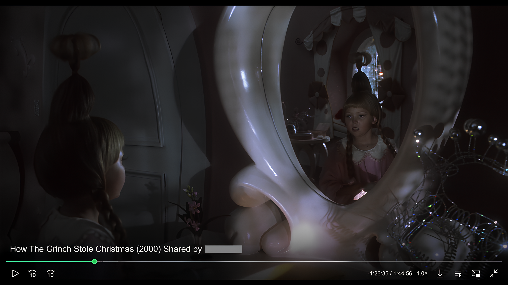
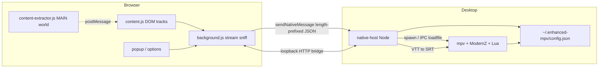

<div align="center">

# Enhanced MPV

**Turn stock mpv into a VLC-class player with one-click playback from your browser.**

[](https://github.com/nihal6886/enhanced-mpv/releases/latest)
[](https://github.com/nihal6886/enhanced-mpv/actions/workflows/ci.yml)
[](LICENSE)


[Demo](#demo) · [Quick Start](#quick-start) · [Features](#features) · [Architecture](#architecture--pipelinestate) · [Shortcuts](#keyboard-and-mouse) · [Troubleshooting](#troubleshooting)



</div>

## Overview

Enhanced MPV is a cross-platform media ecosystem built around [mpv](https://mpv.io). It pairs the [ModernZ](https://github.com/Samillion/ModernZ) interface, [thumbfast](https://github.com/po5/thumbfast) hover thumbnails, and automatic subtitles ([mpv-sub-select](https://github.com/CogentRedTester/mpv-sub-select) plus a cloud lookup) with a Manifest V3 browser extension that hands any stream on the web to mpv in a single click.

mpv is never forked or recompiled. The entire project is Lua, `mpv.conf`, and a stdio JSON host, so every layer can be upgraded independently.

## Demo

<!-- To get an inline video player: edit this file on github.com, drag test-clip.mp4 into the editor,
     then replace the link below with the https://github.com/user-attachments/assets/... URL on its own line. -->
[Watch the demo clip](docs/screenshots/test-clip.mp4)

## Why Enhanced MPV

| You want | Enhanced MPV gives you |
|---|---|
| Playback that just works | Site-agnostic stream selection across YouTube, HLS, DASH, embeds, and direct files |
| A familiar interface | VLC-style controls with a modern neon-green UI and searchable menus |
| Subtitles without effort | Automatic local and cloud lookup, repair, and one-key sync |
| **Speed** | **Zero-Wait Shadow Pre-Load: click-to-playback in under 5 ms** |
| Control | One config file shared by the browser extension, the host, and Lua |

## Quick Start

Setup takes two steps: run the installer, then load the extension.

### 1. Install

**Windows**

```powershell
# One-liner (zero SmartScreen, runs in memory)
irm https://raw.githubusercontent.com/nihal6886/enhanced-mpv/main/scripts/install.ps1 | iex
```

**Linux and macOS**

```bash
chmod +x scripts/install.sh native-host/host.sh
./scripts/install.sh
```

The installer registers the native host, deploys the mpv config, and links the browser extension automatically.


### 2. Load the extension

1. Open `chrome://extensions` (or `brave://extensions`, `edge://extensions`).
2. Enable **Developer mode**, choose **Load unpacked**, and select the `browser-extension` folder.

Done. Open any video page and click the extension icon.

## Features

### Playback and interface

- **ModernZ UI** with dark studio backgrounds (`#0D1117`), neon-green accents (`#4ADE80`), and rounded cards. The same theme runs through the extension popup, the loading screen, the installer, and the onboarding page.
- **Floating Quality, Audio, and Subtitle menus** with full keyboard and mouse support.
- **Quality tiers** (`q`): master `#EXT-X-STREAM-INF` variants expand into discrete tiers (`4K`, `1440p`, `1080p`, `720p`, `480p`) with bandwidth labels.
- **Scraped sources and mirrors** (`Shift+Q`) render as crisp `\n`-separated ASS cards. Stream swaps preserve `time-pos`.
- **Dynamic window resizing** that matches the aspect ratio of any format, including 9:16 vertical video.
- **Timestamp resume**, so you continue exactly where you left off in the browser.
- **Foreground focus**: Win32 FFI (`ShowWindow`, `BringWindowToTop`, `AttachThreadInput` + `SetForegroundWindow`) makes the player pop in front of the browser on launch.
- **Centered loading overlay**: a 60 fps `#4ADE80` pulse ring with the title above it, rendered on the first tick and faded out over 150 ms once a real frame arrives.

### Instant manual launch

mpv never launches on its own when a page starts playing. Every launch is user-triggered, from the toolbar popup's **Launch in Enhanced MPV** button, the `Alt+M` global shortcut, or the optional **hover pill**.

- **Hover pill**: an auto-hiding pill (`#0D1117` + `#4ADE80`) appears at the top-right of active `<video>` elements at least 320 × 180, showing `SHADOW READY` or `OPEN IN MPV`. It lives in a closed Shadow DOM, so page styles can't touch it.
- **Instant bandwidth release (`TAKEOVER_PAUSE`)**: the moment you launch, the tab's `<video>` element is paused and muted. The browser stops downloading duplicate HLS/DASH segments and mpv gets the full connection.
- **Zero-Wait Shadow Pre-Load**: a hidden standby mpv loads the stream paused while you are still on the page, so the window opens already playing Frame 1 in under 5 ms. See [Architecture](#architecture--pipelinestate).
- **Fast demuxer and decoder tuning** (`mpv.conf`, `mpv-launcher.js`) for streams that were not preloaded: `--demuxer-lavf-probesize=131072`, `--demuxer-lavf-analyzeduration=0.25`, `--cache-pause-initial=no`, `--cache-pause-wait=0.1`, and `--hwdec=d3d11va` with an `auto-copy` fallback.
- **Automatic failover**: if the top-ranked stream fails to produce a frame within 1.5 s, the launcher moves to the next candidate without user input.

### Browser bridge

- **Site-agnostic stream intelligence** with no hardcoded site hacks. Candidates are ranked by live segment traffic, muxed-master preference, and `yt-dlp` extractor priority (see [Stream selection](#deep-dives)).
- **In-page extractor** (`content-extractor.js`) that reads YouTube's `adaptiveFormats` straight from page memory in under 1 ms, with no `yt-dlp` cold spawn. The same tiers feed the popup quality dropdown and mpv's `q` / `Shift+Q` menus.
- **Header preservation** for hotlink-protected and authenticated streams: per-iframe `Referer`, `Origin`, `Cookie`, and `User-Agent` are forwarded on every proxied manifest and segment by `stream-relay.js`.
- **Live pipeline status** in the popup (stage pill, `SHADOW READY` badge) and in the player loading screen.
- **CSP-clean popup**: `popup.html` loads `popup.js` externally, so DevTools reports zero CSP errors.

### Subtitles

- Automatic local scan, hash lookup, and release-name parsing
- Encoding repair, dual subtitles, and auto-sync with `ffsubsync` or `alass`
- Prefetch of the next playlist item's subtitles

## Architecture & PipelineState



| Directory | Role |
|---|---|
| `/browser-extension` | MV3 service worker (`background.js`): sniffs `.m3u8`, `.mpd`, `.mp4`, `.mkv`, `.webm` and captions, badge, context menus, stream scoring, prewarm triggers. Also `content-extractor.js` (MAIN world) and the popup |
| `/native-host` | Native Messaging framing and sanitization, subtitle download and conversion, mpv IPC, audio pairing, `launch-daemon.js` (persistent socket, standby mpv), `stream-relay.js` (header forwarding, RAM Segment Ring) |
| `/mpv-config` | `mpv.conf`, `input.conf`, ModernZ, thumbfast, and mpv-sub-select options, plus Lua scripts: `player-menus.lua`, `stream-controller.lua`, `loading-screen.lua`, `window-icon.lua`, `dev-tools.lua` |
| `/installer` | Inno Setup wizard (dark theme), onboarding page, `rcedit` icon stamping, `ie4uinit` |
| `/scripts` | One-command installers (`.ps1` / `.sh`), extension packaging, benchmark suite |

JSON contracts (play payload, host replies, user config) are documented in `.cursorrules`.

### Pipeline stages

`launch-daemon.js` is the single source of truth for one event-driven state machine:

```
SNIFFING → PROBING → PREWARMING → SHADOW_READY → LAUNCHING → PLAYING
                                       ↓
                                   FAILOVER
```

| Stage | Trigger | Action |
|---|---|---|
| `SNIFFING` | Tab detects media | `background.js` sniffs passively; `content-extractor.js` hooks player init |
| `PROBING` | First candidates ranked | Daemon validates the top candidate; `stream-controller.lua` arms failover |
| `PREWARMING` | Verified candidate arrives | RAM Segment Ring fills; standby mpv loads the stream paused at the tab's time |
| `SHADOW_READY` | mpv emits `video-out-params` (`width > 0`, `height > 0`) | `frameReady = true`; the next launch takes the hot path |
| `LAUNCHING` | User clicks Launch or presses `Alt+M` | Hot or cold path (below) |
| `PLAYING` | Frame 1 confirmed | Failover disarmed |
| `FAILOVER` | `end-file` error, or no `video-out-params` within 1.5 s | Swap to the next candidate at the current `time-pos` |

If the sniffer finds a verified working link while mpv is buffering or failing over, `stream-controller.lua` hot-swaps to it at the current `time-pos`.

### Zero-Wait Shadow Pre-Load

**Pass A: in-page extractor** (`browser-extension/content-extractor.js`). A `MAIN`-world content script (`run_at: "document_start"`, `all_frames: true`) hooks player initialization in page memory with zero extra HTTP requests:

- Reads `window.ytInitialPlayerResponse`, `movie_player.getPlayerResponse()`, and `fetch`/`XHR` responses for `/youtubei/v1/player` to extract `streamingData.adaptiveFormats` (all video and audio URLs from `2160p` down to `360p`, plus codecs, bitrates, and title).
- Hooks `Hls.prototype.loadSource`, `shaka.Player.prototype.load`, `MediaSource.addSourceBuffer`, and the `HTMLMediaElement.src` setter to capture master `.m3u8` / `.mpd` URLs before any segment downloads.
- Forwards results through `window.postMessage` to the content script, then `background.js`, which merges them into the canonical `StreamCandidate` schema (`{ id, title, url, audioUrl, streamType, headers, audioHeaders, qualities, score, verified }`) and pushes them to the daemon over the loopback HTTP bridge as a candidates-update dispatch.

**Pass B: RAM Segment Ring and standby pre-buffering** (`stream-relay.js`, `launch-daemon.js`, `mpv-launcher.js`):

- **RAM Segment Ring**: an in-memory LRU prefetch cache (32 MiB total, 60 s TTL). When `/prewarm-stream` or `sniffer:candidates-updated` arrives, it fetches the top candidate's master playlist, best variant playlist, `EXT-X-MAP` init segment, and Segments #0 and #1, then serves them to mpv over `127.0.0.1` in under 0.5 ms. `/prewarm-stream` also registers split-HLS relay routes and headers before launch.
- **Standby mpv**: a hidden `enhanced-mpv.exe --idle=yes --force-window=no` stays running with its IPC socket pre-connected. When a verified candidate arrives for the active tab, the daemon silently issues `loadfile` with `pause=yes,start=+<tabTime>`, so mpv opens the demuxer, initializes hardware decoding, and buffers Frame 1 while you are still on the page. The daemon tracks `{ preloadedCandidateId, preloadedTabId, frameReady }`.
- **Instant relaunch**: when the persistent socket closes or `enhanced-mpv.exe` exits, the daemon immediately spawns a fresh hidden standby and reconnects, so the next launch is fast too.

**Launch paths**

| Path | Condition | IPC sequence | Result |
|---|---|---|---|
| **Hot** | `frameReady === true` and the candidate matches | `seek` (`absolute+exact`) → `pause=no` → `force-window=yes` → `enhanced-mpv-focus` | Window opens already playing Frame 1 in under 5 ms. The loading screen is skipped |
| **Cold** | `frameReady === false`, or the quality or source changed | `force-window=yes` → `enhanced-mpv-focus` → `enhanced-mpv-loading` → `loadfile` | Loading animation renders on the first frame, without waiting on `start-file` or `ytdl_hook`, then fades out when `video-out-params` confirms a real frame |

On the cold path the three setup messages are flushed before `loadfile`, and each reply is checked for `{"error":"success"}`.

### Persistent IPC socket

`input-ipc-server` is the Windows named pipe `\\.\pipe\enhanced-mpv-socket` (Unix socket `~/.enhanced-mpv/mpv-socket` on Linux and macOS). The native host keeps a persistent, auto-reconnecting `net.Socket` to it, so clicking **Launch** flushes its commands without a per-click reconnect. Disk writes (`sources.json`, `last-launch.log`) are deferred with `setImmediate` until after the `loadfile` flush.

### State synchronization

- **Loopback HTTP bridge**: `background.js` ↔ `launch-daemon.js` over `127.0.0.1` (`/health`, `/state`, `/dispatch`, `/play`, `/prewarm-stream`), carrying candidate updates and player state.
- **Persistent IPC pipe**: `launch-daemon.js` ↔ mpv, carrying `observe_property` events and script messages.
- **One `PipelineState` event**, `{ stage, candidate, qualities, candidates, relayStats, frameReady, prewarmMs, launchMs }`, consumed by:
  - `popup.js`: live stage pill, `SHADOW READY` badge, instant quality selector
  - `loading-screen.lua`: 60 fps ASS splash, rendered only when `stage !== "SHADOW_READY"`
  - `stream-controller.lua`: seamless `q` / `Shift+Q` switching, failover, hot-swap
  - `dev-tools.lua`: the `Ctrl+Shift+D` inspector HUD

### Key source files

| Area | File |
|---|---|
| Launch daemon and persistent socket | [`launch-daemon.js`](https://github.com/nihal6886/enhanced-mpv/blob/main/native-host/launch-daemon.js) |
| Stream scoring and header capture | [`background.js`](https://github.com/nihal6886/enhanced-mpv/blob/main/browser-extension/background.js) |
| Quality and source menus | [`player-menus.lua`](https://github.com/nihal6886/enhanced-mpv/blob/main/mpv-config/scripts/player-menus.lua) |
| Window focus | [`window-icon.lua`](https://github.com/nihal6886/enhanced-mpv/blob/main/mpv-config/scripts/window-icon.lua) |
| Loading overlay | [`loading-screen.lua`](https://github.com/nihal6886/enhanced-mpv/blob/main/mpv-config/scripts/loading-screen.lua) |
| Popup | [`popup.html`](https://github.com/nihal6886/enhanced-mpv/blob/main/browser-extension/popup.html), [`popup.js`](https://github.com/nihal6886/enhanced-mpv/blob/main/browser-extension/popup.js) |
| mpv config and installer | [`mpv.conf`](https://github.com/nihal6886/enhanced-mpv/blob/main/mpv-config/mpv.conf), [`installer/setup.iss`](https://github.com/nihal6886/enhanced-mpv/blob/main/installer/setup.iss), [`scripts/install.ps1`](https://github.com/nihal6886/enhanced-mpv/blob/main/scripts/install.ps1), [`onboarding/index.html`](https://github.com/nihal6886/enhanced-mpv/blob/main/installer/onboarding/index.html) |
| Launch benchmark | [`benchmark-launch.js`](https://github.com/nihal6886/enhanced-mpv/blob/main/scripts/benchmark-launch.js) |

## Keyboard and Mouse

VLC-style parity, with extras for power users.

<details open>
<summary><strong>Core controls</strong></summary>

| Input | Action |
|---|---|
| Left click | Play / pause |
| Double-click | Fullscreen |
| Right-click | Searchable ModernZ menu |
| Scroll wheel | Volume |
| `Space` | Pause |
| `f` / `Enter` | Fullscreen |
| `Ctrl+O` / `Ctrl+L` | Open file / Open URL (OS dialogs) |
| `Ctrl+B` | Save bookmark |
| `Ctrl+S` | Screenshot with subtitles to `~/Pictures/mpv-shots` |
| `L` | A-B loop |
| `1` to `5` | 0.5x / 1x / 1.25x / 1.5x / 2x (pitch correction on) |
| `/` | Search dialogue and jump |
| `E` | Next episode now |
| `t` | Always on top |
| `Alt+M` | **Manual instant launch**: opens the active video in Enhanced MPV (hover pill or current tab) |
| `Ctrl+Q` / window close | Quit mpv (position saved). `q` does **not** quit, it opens the Quality menu |

</details>

<details>
<summary><strong>Subtitles and audio</strong></summary>

| Input | Action |
|---|---|
| `z` / `x` | Subtitle delay -/+ 0.1 s |
| `Ctrl+Z` | Reset subtitle delay |
| `Alt+S` | Search and browse the top 10 cloud subtitles |
| `Alt+Y` | Auto-sync (`ffsubsync` or `alass`) |
| `Alt+D` | Dual subtitles (bottom and top) |
| `Alt+N` | Night Mode (`loudnorm`) |
| `Alt+H` | Hardware decode and software fallback toggle |
| `Alt+R` | Reload stream at current timestamp |

</details>

<details>
<summary><strong>ModernZ menus</strong></summary>

| Key | Action |
|---|---|
| `q` | Open the **Quality Tiers** menu (4K / 1440p / 1080p / 720p / 480p) |
| `Shift+Q` | Open the **Sources / Mirrors** menu (scraped candidates with auto-failover) |
| `a` / `Ctrl+Alt+a` | Open the Audio menu |
| `s` / `Ctrl+Alt+s` | Open the Subtitles menu |
| `Esc` | Hide menu |
| Arrow keys | Navigate |
| `Enter` | Select |
| `Ctrl+Left` / `Ctrl+Right` | Audio sync -50 ms / +50 ms |
| `Ctrl+Down` | Reset audio sync |

Menus use dark studio (`#0D1117`) backgrounds, neon-green (`#4ADE80`) accents, rounded cards, hover states, and active checkmarks.

</details>

<details>
<summary><strong>Dev tools and debugging</strong></summary>

| Key | Action |
|---|---|
| `Ctrl+Shift+D` | Toggle the **Stream & Sniffer Inspector HUD**: loopback bridge status, candidate count, active candidate (idx/total), stream type (HLS/DASH/DIRECT/YTDLP), resolved vs local relay URL, forwarded headers (Referer, Origin, Cookie, User-Agent, Authorization status), codecs and resolution, demuxer cache seconds, recent IPC/demuxer errors, and live telemetry (time-pos, pause, buffering), plus the current `PipelineState` and RAM Ring stats |
| `i` | Toggle ModernZ stats overlay |
| `` ` `` | Toggle ModernZ console |

</details>

The player relies on native Windows chrome (`border=yes`) for the minimize, maximize, and close buttons. This keeps them pixel-aligned and preserves Aero Snap.

## Deep Dives

<details>
<summary><strong>Stream selection and resource gating</strong></summary>

<br>

A deterministic pipeline replaces ad-hoc URL sorting with a fast, bounded scoring function, `scoreStreamCandidate()`, running inside the extension background page.

**Resource bounds**

- Maximum of 15 tracked streams per tab (LRU eviction)
- Maximum of 1 in-flight manifest probe per URL (deduplicated through the `manifestResolution` Map)
- 2.5 s `AbortController` timeout on every fetch
- Zero polling loops, fully event-driven

**Scoring signals**

| Signal | Description | Weight |
|---|---|---|
| **A: Live segment confirmation** | `webRequest.onBeforeRequest` tracks `.ts`, `.m4s`, `.aac`, `.mp4` chunk traffic per tab and matches chunks to their parent `.m3u8` / `.mpd` by URL path prefix and query signature. The stream the browser is actually downloading chunks for always beats dead or stub playlists. | +4000 |
| **B: Muxed master vs. proxy** | Prefer self-contained muxed masters (`#EXT-X-STREAM-INF` with combined audio and video, or an `mpd` `AdaptationSet`) over reverse-proxy wrappers (`/proxy`, `m3u8_proxy`, `cors-anywhere` patterns) on the same tab. | +2000 muxed master, -2000 proxy wrapper |
| **C: Session-bound XHR vs. extractor** | When a page is supported by `yt-dlp` and intercepted chunk URLs carry expiring tokens (`expire=`, `sig=`, `lsig=`, `pot=`, `token=`), rank the pre-extracted `yt-dlp` stream and its quality tiers first. All intercepted network streams stay in `candidates[]` as fallbacks. | Page stream = `MAX_SAFE_INTEGER` |

**Base scores**

| Stream type | Base score | Kind | Key behavior |
|---|---|---|---|
| **yt-dlp canonical pages** (YouTube, Vimeo, Twitch, etc.) | `Number.MAX_SAFE_INTEGER` | `ytdlp` | Clean page URL handed to mpv and yt-dlp; raw `googlevideo.com` chunks ignored |
| **HLS muxed master** (`master.m3u8`, `index.m3u8` with `#EXT-X-MEDIA` audio) | +7000 | `hls-master` (`isMuxedMaster=true`) | Supplies video and audio. Resolution weight (+400 4K, +300 1080p, +200 720p), direct CDN bonus (+100), bandwidth hint (capped at 500) |
| **HLS master** (split audio) | +5000 | `hls-master` | Supplies video variants; audio paired from the tab |
| **DASH MPD** (`.mpd`) | +1200 | `dash` | Resolution weight |
| **Progressive direct media** (`.mp4`, `.mkv`, `.webm`) | +800 | `progressive` | Resolution weight; ignores tiny UI and preview clips |
| **Video-only sub-playlists** (non-master `.m3u8`) | +500 | `hls-video-only` | Auto-paired with the highest-bitrate audio sub-playlist on the same tab |
| **Audio-only sub-playlists** (`/audio/`, `mp4a`, `TYPE=AUDIO`) | +100 | `hls-audio-only` | Never played alone; paired with video |

**Audio pairing for split HLS and DASH.** A video-only sub-playlist is paired with the highest-bitrate audio-only sub-playlist on the same tab. The audio inherits the video session's `Cookie`, `Referer`, `Origin`, and `User-Agent`. If the audio is protected, the native host starts an authenticated **localhost HLS relay** ([`stream-relay.js`](https://github.com/nihal6886/enhanced-mpv/blob/main/native-host/stream-relay.js)) and passes `--audio-file=<relayedAudioUrl>` to mpv for lockstep A/V playback.

**Per-request header preservation.** The extension captures the exact inner-iframe `Referer`, `Origin`, `Cookie`, and `User-Agent` through `webRequest.onBeforeSendHeaders` with `extraHeaders`, using `details.initiator` and `documentUrl` as fallbacks. Iframe embeds keep their own headers and are never overwritten by the parent tab URL. See [`background.js:368-396`](https://github.com/nihal6886/enhanced-mpv/blob/main/browser-extension/background.js#L368-L396).

</details>

<details>
<summary><strong>Subtitle automation</strong></summary>

<br>

On `file-loaded`, `smart-sub-manager.lua` runs this sequence:

1. Applies [mpv-sub-select](https://github.com/CogentRedTester/mpv-sub-select) rules: English audio gets forced or signs tracks; foreign audio gets full English.
2. Scans locally with fuzzy matching (`sub-auto=fuzzy`, `sub-file-paths=ass:srt:sub:subs:subtitles`).
3. If nothing matches, computes the OpenSubtitles movie hash (async `curl`, 10 s timeout, exponential backoff) or parses messy torrent names (strips `1080p`, `x265`, `WEB-DL`, and similar tags).
4. Downloads the best `.srt` as `<video>.<lang>.srt` next to the file (VLC-compatible), or into a temp directory for streams, then runs `sub-add`.
5. Repairs Windows-1252 and ISO-8859 encodings through `iconv` so glyphs never become boxes.
6. Shows OSD toasts: `Searching subtitles...`, `Loaded English subtitle`, `No match found`.
7. Treats cloud lookup as **keyless-optional**. Local files and captured web `vtt` and `srt` always work. Add a free [OpenSubtitles](https://www.opensubtitles.com/en/consumers) API key in the extension Settings page for hash search.
8. Runs `ffsubsync` or `alass` in a subprocess on `Alt+Y` and hot-reloads the retimed file.
9. Deletes temp stream subtitles older than 7 days on shutdown.
10. Prefetches the next playlist item's subtitles during the last 45 seconds.

The playback thread is never blocked: all HTTP uses `mp.command_native_async`.

</details>

<details>
<summary><strong>Browser integration</strong></summary>

<br>

- Passive `webRequest` sniffing of media and captions; tracking pixels, ads, and `.ts` chunks are dropped.
- Master `.m3u8` variants are sorted by bandwidth, and the best is pre-selected.
- The content script reads `<video>` and `<track kind="subtitles">`.
- Context menus: **Play Now in Enhanced MPV**, **Queue in MPV**, **Play Link in Enhanced MPV**.
- The popup lists streams and subtitles, shows a badge count, and offers an auto-intercept toggle.
- The payload includes URL, title, Referer, User-Agent, cookies (when permitted), extra headers (Jellyfin, Plex, and Emby `Authorization`), subtitle URLs, a **paired `audioUrl` for split HLS**, and **`audioHeaders` for the relay**.
- Failures return `{ ok, error, code, command }`, so the popup can explain DRM or expired tokens and offer **Copy mpv CLI command**.
- Prewarmed streams also get fast cache flags: `--cache=yes`, `--demuxer-readahead-secs=8`, `--hls-bitrate=max`.

</details>

<details>
<summary><strong>YouTube and custom web players</strong></summary>

<br>

The extension picks the right strategy per site.

**yt-dlp platforms** (youtube.com, youtu.be, vimeo.com, twitch.tv, reddit.com, x.com, twitter.com, dailymotion.com, bilibili.com)

- Raw segmented chunk URLs (`googlevideo.com`, `.m4s`, `.ts`) are filtered out.
- The clean canonical **Page URL** becomes the pre-selected primary item, labelled `Page Stream via yt-dlp (Best Video + Audio + Captions)`.
- Clicking Play hands the page URL to mpv and yt-dlp with `--ytdl-format=bestvideo[height<=2160][vcodec!*=av01]+bestaudio/bestvideo[height<=1080]+bestaudio/best` (or your configured max resolution), `--ytdl-raw-options=no-playlist=,no-check-certificates=,write-auto-subs=,sub-langs=en.*,format-sort=height,ext`, and `--sub-auto=fuzzy`. YouTube opens fast in 1080p or 4K with audio and English captions already attached.
- The broken `extractor-args=youtube:player_client=android_vr`, which caused 403 EOFs on adaptive streams, has been removed.
- The in-page extractor (see [Architecture](#architecture--pipelinestate)) fills the quality dropdown without any `yt-dlp` call for the initial stream list.

**Every other site** (custom embeds, anime players, self-hosted Jellyfin, Plex, Emby)

- The passive `webRequest` sniffer remains the primary detector for `.m3u8`, `.mpd`, `.mp4`, `.mkv`, plus `.vtt` and `.srt` captions.
- Master manifests (`master.m3u8`, `index.m3u8`, or any playlist without chunk indices) always rank above media-segment sub-playlists, so the full-quality variant wins.
- Referer and Origin are captured per tab, so streams behind hotlink checks receive both in `--http-header-fields`. Commas inside header values are escaped (`\,`), so a URL containing commas never splits into malformed headers.
- For obfuscated or blob-encrypted players, the popup always offers **Fallback: Open Page URL via yt-dlp**.

Captured WebVTT is repaired on the way in. NOTE, STYLE, and REGION blocks, cue positioning tags (`align:start position:0%`), and HTML entities are stripped so mpv never shows raw markup.

</details>

## Configuration

`~/.enhanced-mpv/config.json` is created by the installer and shared by the host and Lua. It covers:

- Preferred subtitle and native audio languages
- OpenSubtitles credentials
- yt-dlp format, queue mode, and clipboard watch
- Custom profiles (Anime Upscale, Battery Saver, Cinema HDR) switchable from the ModernZ menu

The extension **Settings** page reads and writes this file through the native host, so no hand-edited conf is needed for day-to-day use.

## Windows Install Options

Both options register the native host, deploy the mpv config, and link the browser extension automatically.

1. **Smart Web Installer.** Download `EnhancedMPV-Setup.exe` from the [latest release](https://github.com/nihal6886/enhanced-mpv/releases/latest) and run it. The Inno Setup wizard uses the dark studio theme (`#0D1117` + `#4ADE80`) with custom bitmaps, creates a Start Menu **Uninstall Enhanced MPV** shortcut, and stamps the emerald icon onto both `enhanced-mpv.exe` and `mpv.exe` via `rcedit`. It runs `ie4uinit.exe -show` to refresh shell icons immediately.

2. **Zero-SmartScreen one-liner** (see [Quick Start](#quick-start)). A plain PowerShell script is fetched and executed in memory. Nothing is written to disk as a `.exe`, so SmartScreen has nothing to block.

To link an unpacked build's own extension ID:

```powershell
$env:ENHANCED_MPV_EXTENSION_ID = "aaaaaaaaaaaaaaaaaaaaaaaaaaaaaaaa"
irm https://raw.githubusercontent.com/nihal6886/enhanced-mpv/main/scripts/install.ps1 | iex
```

### Verify downloads

Every release ships a `SHA256SUMS.txt` next to the binaries. Check the `.exe` before running it:

```powershell
irm https://github.com/nihal6886/enhanced-mpv/releases/latest/download/SHA256SUMS.txt
Get-FileHash .\EnhancedMPV-Setup.exe -Algorithm SHA256   # compare with the matching line
```

### Onboarding

After install, the onboarding page (`installer/onboarding/index.html`) opens with the same dark studio theme and a copyable `%LOCALAPPDATA%\Programs\Enhanced MPV\extension` path for the **Load unpacked** step in `chrome://extensions`.

## Troubleshooting

| Symptom | What to do |
|---|---|
| Native host "not found" | Re-run the installer with the real unpacked extension ID, then check `node native-host/doctor.js` |
| YouTube opens black or shows -0:00 EOF | Confirm `yt-dlp` is on PATH. The host passes `--ytdl-format=bestvideo[height<=2160][vcodec!*=av01]+bestaudio/bestvideo[height<=1080]+bestaudio/best` for page URLs, and `android_vr` is removed |
| DRM or Widevine sites | Cannot be decrypted. Use a normal download or stream URL, or copy the CLI command from the popup to inspect |
| Garbled subtitles | `iconv` is missing, or open the subtitle file after converting it to UTF-8 |
| No ModernZ UI | The installer must download ModernZ (with thumbfast and mpv-sub-select) into `~/.config/mpv/scripts` (`%APPDATA%\mpv` on Windows). Re-run `scripts/install.ps1` or `scripts/install.sh` |
| IPC queue does nothing | The first window must be an Enhanced MPV instance. `doctor` shows `ipc (live)` while playing |
| Auto-sync fails | Run `pip install ffsubsync` or install `alass`. Works for local files with external subtitles only |
| Split HLS has no audio | The engine auto-pairs video-only with audio-only sub-playlists. Check relay logs in `last-launch.log` |

### Diagnostic logs

- **`last-launch.log`**: native host `dispatch` entry, payload, result, and timing (written to `configDir()`).
- **`mpv-runtime.log`**: mpv stderr/stdout captured by the host subprocess.
- **`doctor.js`**: run `node native-host/doctor.js` for a full health report covering the mpv path, ModernZ install, yt-dlp/ffmpeg/ffsubsync/curl/iconv presence, config paths, IPC pipe status, native messaging registration, and platform info.
- **Inspector HUD**: press `Ctrl+Shift+D` in the player for live pipeline, relay, and header state.

## Benchmarks

Run `node scripts/benchmark-launch.js --runs=25` (or `npm run benchmark` if defined).

| Scenario | Target | Typical (median) |
|---|---|---|
| Persistent-socket IPC dispatch (pre-connected) | **< 3 ms** | ~0.05–0.08 ms |
| Loopback-to-pipe (daemon HTTP + persistent pipe) | **< 10 ms** | ~0.8 ms |
| Named-pipe IPC dispatch (per-connection) | < 100 ms | ~0.3 ms |
| Loopback daemon dispatch (HTTP) | < 100 ms | ~1.6 ms |
| **Zero-Wait Hot Path** (preloaded + `frameReady`, including manual launch with `TAKEOVER_PAUSE`) | **< 5 ms** | ~2–3 ms |
| **Cold Path** (loading screen + `loadfile`, including manual launch with `TAKEOVER_PAUSE`) | **< 100 ms** | ~30–50 ms |

## Development

```bash
npm install
npm test
npm run lint:js
# luacheck mpv-config/scripts   (CI installs lua-check)
npm run package
```

CI is defined in `.github/workflows/ci.yml` and runs eslint, luacheck, node tests, and the extension zip build.

## Uninstall

```bash
./scripts/install.sh --uninstall
# Windows: .\scripts\install.ps1 -Uninstall
```

This restores the most recent `mpv.conf` and `input.conf` backup and removes the native-messaging registration.

## License

Released under the [MIT License](LICENSE). Third-party projects (mpv, ModernZ, thumbfast, mpv-sub-select) are fetched dynamically at install time and keep their own upstream licenses. This repository vendors configuration and glue only. See [LICENSE](LICENSE) for the full text and third-party notice.
