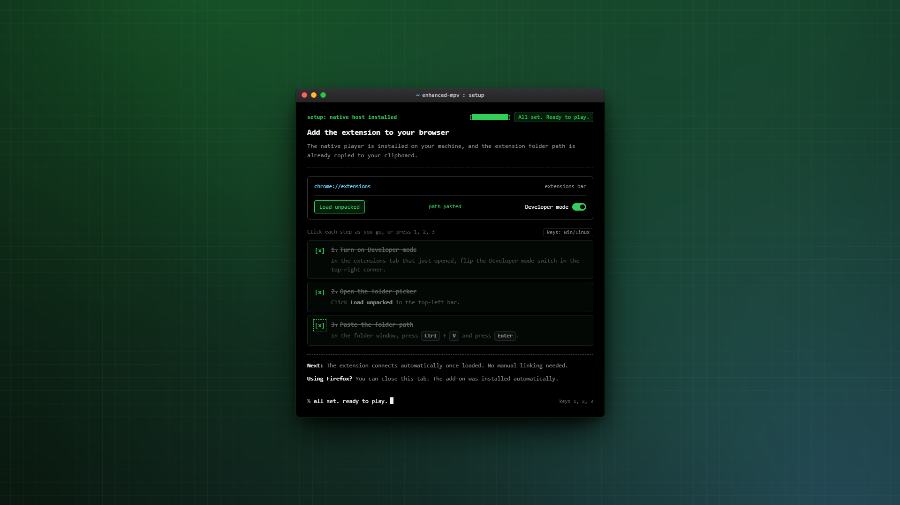
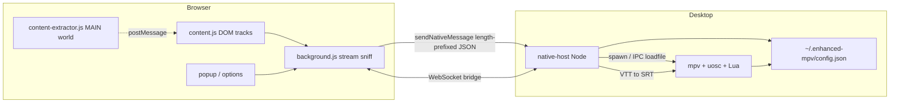

<div align="center">

# Enhanced MPV

**Turn stock mpv into a VLC-class player with one-click playback from your browser.**

[](https://github.com/nihal6886/enhanced-mpv/releases/latest)
[](https://github.com/nihal6886/enhanced-mpv/actions/workflows/ci.yml)
[](LICENSE)


[Demo](#demo) · [Quick Start](#quick-start) · [Features](#features) · [Architecture](#architecture) · [Shortcuts](#keyboard-and-mouse) · [Troubleshooting](#troubleshooting)


</div>

## Overview

Enhanced MPV is a cross-platform media ecosystem built around [mpv](https://mpv.io). It pairs the [uosc](https://github.com/tomasklaen/uosc) interface, hover thumbnails, and automatic subtitles with a Manifest V3 browser extension that hands any stream on the web to mpv in a single click.

mpv is never forked or recompiled. The entire project is Lua, `mpv.conf`, and a stdio JSON host, so every layer can be upgraded independently.

## Demo

<!-- To get an inline video player: edit this file on github.com, drag test-clip.mp4 into the editor,
     then replace the link below with the https://github.com/user-attachments/assets/... URL on its own line. -->
[Watch the demo clip](docs/screenshots/test-clip.mp4)

## Why Enhanced MPV

| You want | Enhanced MPV gives you |
|---|---|
| Playback that just works | Universal site-agnostic stream selection across YouTube, HLS, DASH, embeds, and direct files |
| A familiar interface | VLC-style controls with a modern neon-green UI and searchable menus |
| Subtitles without effort | Automatic local and cloud lookup, repair, and one-key sync |
| **Speed** | **Zero-Wait Shadow Pre-Load: sub-5 ms click-to-playback via RAM Segment Ring & silent standby pre-buffering** |
| Control | One config file shared by the browser extension, the host, and Lua |

## Quick Start

Setup takes two steps: run the installer, then load the extension.

### 1. Install

**Windows**

```powershell
# One-liner (zero SmartScreen, runs in memory)
irm https://raw.githubusercontent.com/nihal6886/enhanced-mpv/main/scripts/install.ps1 | iex
```

**Linux and macOS**

```bash
chmod +x scripts/install.sh native-host/host.sh
./scripts/install.sh
```

The installer registers the native host, deploys the mpv config, and links the browser extension automatically.



### 2. Load the extension

1. Open `chrome://extensions` (or `brave://extensions`, `edge://extensions`).
2. Enable **Developer mode**, choose **Load unpacked**, and select the `browser-extension` folder.

Done. Open any video page and click the extension icon.

## Features

### Playback and interface

- **ModernZ UI** with dark studio backgrounds (`#0D1117`), neon-green accents (`#4ADE80`), and rounded cards
- **Floating popovers** for Quality (`q`), Audio (`Ctrl+Alt+a`), and Subtitles (`Ctrl+Alt+s`) with full keyboard and mouse support
- **Quality tiers** (`q`) expand `#EXT-X-STREAM-INF` variants into discrete tiers (`4K`, `1440p`, `1080p`, `720p`, `480p`)
- **Scraped sources/mirrors** (`Shift+Q`) render crisp `\n`-separated ASS cards and swap streams cleanly while preserving `time-pos`
- **Dynamic window resizing** that matches the aspect ratio of any format, including 9:16 vertical video
- **Timestamp resume** so you continue exactly where you left off in the browser
- **Zero-Wait Shadow Pre-Load Engine** (`Pass A + Pass B`):
  - **Pass A — In-Page MAIN-World Stream Extractor** (`content-extractor.js`): Hooks `window.ytInitialPlayerResponse`, `movie_player.getPlayerResponse()`, and `fetch`/`XHR` for `/youtubei/v1/player` to extract `streamingData.adaptiveFormats` (all working video + audio URLs, `2160p 4K`, `1440p`, `1080p`, `720p`, `480p`, `360p`, codecs, bitrates, title) in **<1ms** — eliminating slow `yt-dlp.exe` cold spawns on YouTube. Hooks `Hls.prototype.loadSource` / `shaka.Player.prototype.load` / `HTMLMediaElement.prototype.src` to immediately capture master `.m3u8`/`.mpd` URLs before media segments even begin downloading.
  - **Pass B — Edge RAM Segment Ring & Silent Paused Standby Pre-Buffering**: In-memory LRU prefetch cache (capped at **32 MiB**, **60-second TTL**) automatically fetches the top candidate's master playlist, highest-ranked variant playlist, `EXT-X-MAP` init segment, and **Segments #0 and #1** into RAM the moment `/prewarm-stream` or `sniffer:candidates-updated` arrives — serving them to `mpv` over `127.0.0.1` in **<0.5ms**.
  - **Silent Paused Pre-Load in Hidden Standby `mpv`**: While `enhanced-mpv.exe` is hidden in standby (`--idle=yes --force-window=no`), when a verified top candidate arrives for the active tab, silently issue `["loadfile", prewarmedUrl, "replace", -1, "pause=yes,start=+<tabTime>"]\n` in the background so `mpv` opens the demuxer, initializes hardware decoding, and buffers Frame 1 while the user is still viewing the webpage. Tracks `{ preloadedCandidateId, preloadedTabId, frameReady }` on daemon state (set `frameReady = true` when `mpv` emits `video-reconfig` / `width > 0` over persistent IPC socket).
  - **Zero-Wait Hot Path** (`frameReady === true` and matching candidate): Skip `loadfile` and loading screen completely — flush `["seek", startTime, "absolute+exact"]\n`, `["set_property", "pause", false]\n`, `["set_property", "force-window", "yes"]\n`, and `["script-message", "enhanced-mpv-focus"]\n` — popping the window open **already playing Frame 1 in <5ms**!
  - **Cold / Unbuffered Path** (`frameReady === false` or user switched quality/source): Immediately flush `["set_property", "force-window", "yes"]\n`, `["script-message", "enhanced-mpv-focus"]\n`, and `["script-message", "enhanced-mpv-loading", title]\n` at **0.05ms before** `["loadfile", ...]\n`, so the centered 60 fps `#4ADE80` loading animation renders on the very first frame without ever waiting on `start-file` or `ytdl_hook`, then cross-fades `\alpha` out over 150ms the exact instant `video-out-params` confirms `width > 0 and height > 0`.
- **Tight Real-Time Sniffer <-> Player State Coordination**: Synchronize sniffer probing state (`SNIFFING` → `PROBING` → `PRELOADED` → `BUFFERING` → `PLAYING` → `FAILOVER`) across `background.js`, `launch-daemon.js`, `loading-screen.lua`, and `dev-tools.lua` (`Ctrl+Shift+D`) over the real-time WebSocket + IPC pipe so the loading screen subtitle and popup status always reflect exact live pipeline progress — and if the sniffer discovers a verified working link while `mpv` is buffering/failing over, `stream-controller.lua` hot-swaps to it immediately at the current `time-pos`.
- **Persistent-socket prewarm** for sub-3 ms click-to-playback (persistent `net.Socket` to `\\.\pipe\enhanced-mpv-socket`, auto-reconnecting)
- **Stream prewarm** (`/prewarm-stream`) registers split-HLS relay routes/headers in memory before launch with fast demuxer flags (`--demuxer-lavf-probesize=65536`, `--demuxer-lavf-analyzeduration=0.15`, `--cache=yes`, `--demuxer-readahead-secs=5`, `--hls-bitrate=max`)
- **Instant relaunch**: when the persistent socket closes or `enhanced-mpv.exe` exits, `launch-daemon.js` immediately spawns a fresh hidden standby `enhanced-mpv.exe --idle=yes --force-window=no` and pre-connects the IPC socket so the next video opens in <3 ms
- **Guaranteed IPC execution order**: `["set_property","force-window","yes"]\n`, `["script-message","enhanced-mpv-focus"]\n`, `["script-message","enhanced-mpv-loading",title]\n` are flushed BEFORE `["loadfile",targetUrl,mode,-1,optsStr]\n`, with JSON IPC reply verification (`{"error":"success"}`)
- **Universal 1.5 s auto-failover**: if candidate #1 fails to initialize `video-out-params` (`width > 0 and height > 0`) within 1.5 seconds or fires an `end-file` error, automatically swap to candidate #2, #3, etc. without user intervention

### TV-Style Manual Instant Launch (v1.2.0+)

- **Manual launch only — zero auto-takeover**: mpv never launches automatically when a webpage starts playing. Every launch is user-triggered via the toolbar popup **Launch in Enhanced MPV** button, `Alt+M` global shortcut, or the optional **hover pill** on the active `<video>` element.
- **Shadow-DOM hover pill** (`#0D1117` + `#4ADE80`): A lightweight auto-hiding pill appears at the top-right of active `<video>` elements (`width >= 320 && height >= 180`) showing `⚡ SHADOW READY` / `▶ Open in MPV` for instant 1-click manual launch without opening the popup. The pill is rendered in a closed Shadow DOM for complete style isolation.
- **Instant browser bandwidth release (`TAKEOVER_PAUSE`)**: The exact millisecond the user clicks Launch, a `TAKEOVER_PAUSE` message is sent to the tab's content script to **immediately pause and mute** the browser's `<video>` element. This stops Brave/Chrome from downloading duplicate HLS/DASH segments and hands 100% of bandwidth to `mpv`.
- **TV-Grade Instant Demuxer & Hardware Decoder Tuning** (`mpv.conf` & `mpv-launcher.js`):
  - `--demuxer-lavf-probesize=32768` (32 KiB)
  - `--demuxer-lavf-analyzeduration=0.1` (100 ms)
  - `--cache-pause-initial=no`
  - `--initial-audio-sync=no`
  - `--hwdec=d3d11va` with `auto-copy` fallback
- **SHADOW_READY zero-wait engine preserved**: Pre-warmed streams in the hidden standby `mpv` (`--idle=yes --force-window=no`) still pop open on Frame 1 in **<5ms** via the Zero-Wait Hot Path (`seek` + `pause=no` + `force-window=yes` + `enhanced-mpv-focus`).

### Browser bridge

- **Universal site-agnostic stream intelligence** (zero hardcoded site-specific hacks):
  - **Signal A (Live Segment Confirmation)**: Tracks `.ts`, `.m4s`, `.aac`, `.mp4` chunk traffic per tab and matches chunks back to their parent `.m3u8`/`.mpd` manifest by URL path prefix/query signature (+4000). The stream the browser is *actually downloading chunks for* always wins over dead/stub playlists.
  - **Signal B (Direct Muxed Master vs. Proxy/Split Penalty)**: Prefers self-contained muxed master manifests (`#EXT-X-STREAM-INF` with combined audio+video or `mpd` `AdaptationSet`) over generic reverse-proxy wrappers (`/proxy`, `m3u8_proxy`, `cors-anywhere` patterns) when both exist on the same tab (+2000 muxed master, -2000 proxy wrapper).
  - **Signal C (Session-Bound XHR vs. Extractor Priority)**: When a page is supported by `yt-dlp` (any site with a canonical page URL where intercepted chunk URLs contain expiring session/signature query tokens like `expire=`, `sig=`, `lsig=`, `pot=`, `token=`), ranks the pre-extracted `yt-dlp` stream + all extracted quality tiers **#1**, while retaining all intercepted network streams in `candidates[]` as fallbacks.
  - **Signal D (1.5s Universal Auto-Failover)**: Passes all ranked `candidates[]` to `mpv-launcher.js`; if candidate #1 fails to initialize `video-out-params` within 1.5 seconds or fires an `end-file` error, automatically swaps to candidate #2, #3, etc.
- **Header preservation** for hotlink-protected and authenticated streams (per-iframe Referer, Origin, Cookie, User-Agent)
- **Universal header & relay integrity**: Forwards the exact tab `Referer`, `Origin`, `User-Agent`, and `Cookie` headers on every proxied manifest and child segment in `stream-relay.js`
- **Instant micro-step feedback** in the extension popup
- **In-Page MAIN-World YouTube Extractor** (`content-extractor.js`): Zero-HTTP extraction of `adaptiveFormats` from YouTube's in-memory player response, populating both the extension popup quality dropdown AND `mpv`'s `q` / `Shift+Q` menus, and pushing immediately over the WebSocket bridge (`sniffer:candidates-updated`).

### Subtitles

- Automatic local scan, hash lookup, and release-name parsing
- Encoding repair, dual subtitles, and auto-sync with `ffsubsync` or `alass`
- Prefetch of the next playlist item's subtitles

### Recent fixes in v1.0.0

- **Persistent-socket launch & pre-warmed stream start**: Maintained persistent `net.Socket` to `\\.\pipe\enhanced-mpv-socket` for <3 ms IPC flush; deferred disk writes via `setImmediate` after `loadfile` flush; added `/prewarm-stream` route for pre-registering relay routes. See [`launch-daemon.js`](https://github.com/nihal6886/enhanced-mpv/blob/main/native-host/launch-daemon.js) and [`benchmark-launch.js`](https://github.com/nihal6886/enhanced-mpv/blob/main/scripts/benchmark-launch.js).
- **Universal site-agnostic stream intelligence**: Live segment scoring (+4000), muxed master preference (+2000), proxy penalty (-2000), yt-dlp extractor priority, 1.5 s auto-failover. See [`background.js`](https://github.com/nihal6886/enhanced-mpv/blob/main/browser-extension/background.js).
- **In-player quality/source menus**: `q` (Quality Tiers) and `Shift+Q` (Scraped Sources/Mirrors) render crisp `\n`-separated ASS cards; clean stream swap preserves `time-pos`. See [`player-menus.lua`](https://github.com/nihal6886/enhanced-mpv/blob/main/mpv-config/scripts/player-menus.lua).
- **Foreground focus & centered loading overlay**: Win32 FFI (`ShowWindow(hwnd, 9)`, `BringWindowToTop(hwnd)`, `AttachThreadInput` + `SetForegroundWindow(hwnd)`) on `force-window=yes` and `enhanced-mpv-focus` so `Enhanced MPV` always pops in front of the browser. Center-aligned (`\an5`) title above pulse ring, renders on first tick (<3 ms), smooth fade `\alpha` out over 150 ms once `video-out-params` confirms real frame. See [`window-icon.lua`](https://github.com/nihal6886/enhanced-mpv/blob/main/mpv-config/scripts/window-icon.lua) and [`loading-screen.lua`](https://github.com/nihal6886/enhanced-mpv/blob/main/mpv-config/scripts/loading-screen.lua).
- **Popup CSP compliance**: Extracted inline `<script>` from `popup.html` into `popup.js` (`<script src="popup.js"></script>`) so DevTools has 0 CSP errors. See [`popup.html`](https://github.com/nihal6886/enhanced-mpv/blob/main/browser-extension/popup.html) and [`popup.js`](https://github.com/nihal6886/enhanced-mpv/blob/main/browser-extension/popup.js).
- **Unified Dark-Studio Theme**: `#0D1117` + `#4ADE80` everywhere—browser extension popup, mpv player (loading-screen.lua, modernz.conf, window-icon.lua), installer & onboarding wizard. See [`popup.html`](https://github.com/nihal6886/enhanced-mpv/blob/main/browser-extension/popup.html), [`mpv.conf`](https://github.com/nihal6886/enhanced-mpv/blob/main/mpv-config/mpv.conf), [`installer/setup.iss`](https://github.com/nihal6886/enhanced-mpv/blob/main/installer/setup.iss).
- **Installer & onboarding**: Dark wizard bitmaps, Start Menu Uninstall shortcut, copyable extension path, `rcedit` icon stamping on `enhanced-mpv.exe` and `mpv.exe`, `ie4uinit.exe -show`. See [`scripts/install.ps1`](https://github.com/nihal6886/enhanced-mpv/blob/main/scripts/install.ps1), [`installer/onboarding/index.html`](https://github.com/nihal6886/enhanced-mpv/blob/main/installer/onboarding/index.html).

### Zero-Wait Shadow Pre-Load Engine (v1.1.0+)

- **Pass A — In-Page MAIN-World Stream Extractor** (`browser-extension/content-extractor.js`):
  - Registers a lightweight `MAIN`-world content script (`run_at: "document_start"`) that hooks player initialization directly in page memory with zero extra HTTP requests.
  - Intercepts `window.ytInitialPlayerResponse`, `movie_player.getPlayerResponse()`, and `fetch`/`XHR` responses matching `/youtubei/v1/player` to extract `streamingData.adaptiveFormats` (all working video + audio URLs, `2160p 4K`, `1440p`, `1080p`, `720p`, `480p`, `360p`, codecs, bitrates, and title) in **<1ms** — eliminating slow `yt-dlp.exe` cold spawns on YouTube.
  - Hooks `Hls.prototype.loadSource` / `shaka.Player.prototype.load` / `HTMLMediaElement.prototype.src` to immediately capture master `.m3u8`/`.mpd` URLs before media segments even begin downloading.
  - Forwards extracted streams via `window.postMessage` → isolated content script → `background.js`, merging them into the canonical `StreamCandidate` schema (`{ id, title, url, audioUrl, streamType, headers, audioHeaders, qualities, score, verified }`), populating **both** the extension popup quality dropdown (`popup.html`/`popup.js`) AND `mpv`'s `q` / `Shift+Q` menus, and pushing immediately over the WebSocket bridge (`sniffer:candidates-updated`).

- **Pass B — Edge RAM Segment Ring & Silent Paused Standby Pre-Buffering** (`native-host/stream-relay.js`, `launch-daemon.js`, `mpv-launcher.js`):
  - **RAM Segment Ring** (`stream-relay.js`): In-memory LRU prefetch cache (capped at **32 MiB total**, **60-second TTL**) that automatically fetches the top candidate's master playlist, highest-ranked variant playlist, `EXT-X-MAP` init segment, and **Segments #0 and #1** into RAM the moment `/prewarm-stream` or `sniffer:candidates-updated` arrives — serving them to `mpv` over `127.0.0.1` in **<0.5ms**.
  - **Silent Paused Pre-Load in Hidden Standby `mpv`** (`launch-daemon.js` & `mpv-launcher.js`):
    - While `enhanced-mpv.exe` is hidden in standby (`--idle=yes --force-window=no`), when a verified top candidate arrives for the active tab, silently issue `["loadfile", prewarmedUrl, "replace", -1, "pause=yes,start=+<tabTime>"]\n` in the background so `mpv` opens the demuxer, initializes hardware decoding, and buffers Frame 1 while the user is still viewing the webpage.
    - Tracks `{ preloadedCandidateId, preloadedTabId, frameReady }` on the daemon state (set `frameReady = true` when `mpv` emits `video-reconfig` / `width > 0` over the persistent IPC socket).
    - When the user clicks **Launch in Enhanced MPV**:
      - **Zero-Wait Hot Path** (`frameReady === true` and matching candidate): Skip `loadfile` and loading screen completely — flush `["seek", startTime, "absolute+exact"]\n`, `["set_property", "pause", false]\n`, `["set_property", "force-window", "yes"]\n`, and `["script-message", "enhanced-mpv-focus"]\n` — popping the window open **already playing Frame 1 in <5ms**!
      - **Cold / Unbuffered Path** (`frameReady === false` or user switched quality/source): Immediately flush `["set_property", "force-window", "yes"]\n`, `["script-message", "enhanced-mpv-focus"]\n`, and `["script-message", "enhanced-mpv-loading", title]\n` at **0.05ms *before*** `["loadfile", ...]\n`, so the centered 60 fps `#4ADE80` loading animation renders on the very first frame without ever waiting on `start-file` or `ytdl_hook`, then cross-fades `\alpha` out over 150ms the exact instant `video-out-params` confirms `width > 0 and height > 0`.

- **Tight Real-Time Sniffer <-> Player State Coordination** (`background.js`, `launch-daemon.js`, `stream-controller.lua`, `loading-screen.lua`):
  - Synchronize sniffer probing state (`SNIFFING` → `PROBING` → `PRELOADED` → `BUFFERING` → `PLAYING` → `FAILOVER`) across `background.js`, `launch-daemon.js`, `loading-screen.lua`, and `dev-tools.lua` (`Ctrl+Shift+D`) over the real-time WebSocket + IPC pipe so the loading screen subtitle and popup status always reflect exact live pipeline progress.
  - If the sniffer discovers a verified working link while `mpv` is buffering/failing over, `stream-controller.lua` hot-swaps to it immediately at the current `time-pos`.

## Architecture



| Directory | Role |
|---|---|
| `/browser-extension` | MV3 service worker, sniffs `.m3u8`, `.mpd`, `.mp4`, `.mkv`, `.webm` and captions, badge, context menus, **persistent-socket prewarm**, **universal site-agnostic stream intelligence**, **MAIN-world content-extractor.js** |
| `/native-host` | Native Messaging framing, sanitization, subtitle download and conversion, mpv IPC, **stream scoring and audio pairing**, **launch-daemon with persistent socket & instant relaunch**, **stream relay with universal header forwarding**, **RAM Segment Ring (32 MiB LRU)**, **silent paused pre-load** |
| `/mpv-config` | `mpv.conf`, `input.conf`, uosc, thumbfast, and sub-select options, Lua automations (**player-menus.lua**, **stream-controller.lua**, loading-screen, modernz, window-icon, **dev-tools.lua**) |
| `/installer` | Inno Setup wizard (dark theme), onboarding page, `rcedit` icon stamping, `ie4uinit` |
| `/scripts` | One-command installers (`.ps1` / `.sh`), extension packaging, benchmark suite |

JSON contracts (play payload, host replies, user config) are documented in `.cursorrules`.

## Unified PipelineState Architecture (v1.2.0+)

The entire mpv-bridge pipeline operates as a **single deeply integrated event-driven state machine** with `launch-daemon.js` as the canonical source of truth.

### Pipeline Stage Machine

```
SNIFFING → PROBING → PREWARMING → SHADOW_READY → LAUNCHING → PLAYING
                                              ↓
                                            FAILOVER
```

**Stages:**

| Stage | Trigger | Action | Observers |
|-------|---------|--------|-----------|
| `SNIFFING` | Tab detects media | background.js begins passive sniffing; content-extractor.js hooks player init | popup.js (stage pill), dev-tools.lua (HUD) |
| `PROBING` | First candidates ranked | Daemon receives `candidates-update`, validates top candidate | stream-controller.lua (arms failover), loading-screen.lua |
| `PREWARMING` | Verified candidate arrives | **RAM Segment Ring** fetches master/variant/init/seg0/seg1 (32 MiB LRU); **Standby mpv** silently loads paused at tab time | stream-controller.lua (updates loading), loading-screen.lua (shows prewarm progress) |
| `SHADOW_READY` | `mpv` emits `video-out-params` (width>0, height>0) | `frameReady=true`; Pipeline ready for instant hot-path launch | **popup.js** (⚡ SHADOW READY badge), **loading-screen.lua** (only renders if stage≠SHADOW_READY) |
| `LAUNCHING` | User clicks Launch / presses Alt+M | Hot path: `seek` → `pause=false` → `force-window=yes` → `enhanced-mpv-focus` (<5ms) | All surfaces show "LAUNCHING..." |
| `PLAYING` | Frame 1 confirmed | Failover disarmed; zero-wait confirmed | dev-tools.lua (live telemetry), stream-controller.lua |
| `FAILOVER` | `end-file` error or 1.8s timeout | Auto-advance to next candidate at current `time-pos` | All surfaces show failover status |

### Real-Time State Synchronization

- **WebSocket Bridge** (RFC 6455): `background.js` ↔ `launch-daemon.js` carries `pipeline:state` events + player telemetry
- **Persistent IPC Pipe** (`\\.\pipe\enhanced-mpv-socket`): `launch-daemon.js` ↔ `mpv` carries `observe_property` events + script-messages
- **Single PipelineState event** `{ stage, candidate, qualities, candidates, relayStats, frameReady, prewarmMs, launchMs }` consumed simultaneously by:
  - `browser-extension/popup.js` — live stage pill, ⚡ SHADOW READY badge, instant quality selector
  - `mpv-config/scripts/loading-screen.lua` — reactive 60 fps ASS splash (renders **only when** `stage !== "SHADOW_READY"`)
  - `mpv-config/scripts/stream-controller.lua` — seamless `q`/`Shift+Q` switching + 1.5s auto-failover + hot-swap on verified link
  - `mpv-config/scripts/dev-tools.lua` — `Ctrl+Shift+D` live telemetry HUD with PipelineState, RAM Ring stats, relay status

### Zero-Wait Hot Path vs Cold Path

| Path | Condition | IPC Sequence | Result |
|---|---|---|---|
| **Hot** | `frameReady === true` && matching candidate | `seek` → `pause=false` → `force-window=yes` → `enhanced-mpv-focus` | Window pops open **already playing Frame 1 in <5ms** |
| **Cold** | `frameReady === false` or quality switched | `force-window=yes` → `enhanced-mpv-focus` → `enhanced-mpv-loading` → `loadfile` (0.05ms before) | Centered 60 fps `#4ADE80` loading animation renders on first frame; cross-fades `\alpha` out over 150ms when `video-out-params` confirms real frame |

### Deep Integration Points

- **Universal Edge Intelligence** (`content-extractor.js` + `background.js`): Hooks `fetch`, `XHR`, `MediaSource.addSourceBuffer`, `HTMLMediaElement.src`, `Hls.loadSource`, `shaka.Player.load`, `ytInitialPlayerResponse`, `/youtubei/v1/player` at `document_start` in `MAIN` world — captures manifests + player JSON in <1ms on any site
- **RAM Segment Ring** (`stream-relay.js`): 32 MiB LRU, 60s TTL — auto-fetches master/variant/init/seg0/seg1 on `PREWARMING` entry
- **Standby mpv** (`launch-daemon.js`): `--idle=yes --force-window=no` pre-spawned, persistent IPC, auto-respawns on exit
- **Cohesive Dark-Studio UI** (`#0D1117` + `#4ADE80`): Consistent across popup, loading-screen, stream-controller menus, dev-tools, modernz.conf, installer

JSON contracts (play payload, host replies, user config) are documented in `.cursorrules`.

## Keyboard and Mouse

VLC-style parity, with extras for power users.

<details open>
<summary><strong>Core controls</strong></summary>

| Input | Action |
|---|---|
| Left click | Play / pause |
| Double-click | Fullscreen |
| Right-click | Searchable uosc menu |
| Scroll wheel | Volume |
| `Space` | Pause |
| `f` / `Enter` | Fullscreen |
| `Ctrl+O` / `Ctrl+L` | Open file / Open URL (OS dialogs) |
| `Ctrl+B` | Save bookmark |
| `Ctrl+S` | Screenshot with subtitles to `~/Pictures/mpv-shots` |
| `L` | A-B loop |
| `1` to `5` | 0.5x / 1x / 1.25x / 1.5x / 2x (pitch correction on) |
| `/` | Search dialogue and jump |
| `E` | Next episode now |
| `t` | Always on top |
| `Alt+M` | **Manual instant launch** — opens active video in Enhanced MPV (hover pill or current tab) |
| `q` | Quit (position saved) |

</details>

<details>
<summary><strong>Subtitles and audio</strong></summary>

| Input | Action |
|---|---|
| `z` / `x` | Subtitle delay -/+ 0.1s |
| `Ctrl+Z` | Reset subtitle delay |
| `Alt+S` | Search and browse the top 10 cloud subtitles |
| `Alt+Y` | Auto-sync (`ffsubsync` or `alass`) |
| `Alt+D` | Dual subtitles (bottom and top) |
| `Alt+N` | Night Mode (`loudnorm`) |
| `Alt+H` | Hardware decode and software fallback toggle |
| `Alt+R` | Reload stream at current timestamp |

</details>

<details>
<summary><strong>ModernZ menus (v1.0.0+)</strong></summary>

| Key | Action |
|---|---|
| `q` | Open **Quality** menu (tiered variants: 4K / 1440p / 1080p / 720p / 480p) |
| `Shift+Q` | Open **Sources / Mirrors** menu (scraped candidates with auto-failover) |
| `a` | Open Audio menu |
| `s` | Open Subtitles menu |
| `Esc` | Hide menu |
| Arrow keys | Navigate |
| `Enter` | Select |
| `Ctrl+Left` | Audio sync -50 ms |
| `Ctrl+Right` | Audio sync +50 ms |
| `Ctrl+Down` | Reset audio sync |

Floating menus use dark studio (`#0D1117`) backgrounds, neon-green (`#4ADE80`) accents, rounded cards, hover states, and active checkmarks. Quality and Sources menus render crisp `\n`-separated ASS cards; stream swaps preserve `time-pos`.

</details>

<details>
<summary><strong>Dev Tools & Debugging</strong></summary>

| Key | Action |
|---|---|
| `Ctrl+Shift+D` | Toggle **Stream & Sniffer Inspector HUD** — Live overlay showing WebSocket Bridge status, candidate count, active candidate (idx/total), stream type (HLS/DASH/DIRECT/YTDLP), resolved URL vs local relay URL, forwarded headers (Referer, Origin, Cookie, User-Agent, Authorization status), video/audio codec & resolution, demuxer cache seconds, recent IPC/demuxer errors, live player telemetry (time-pos, pause, resolution, buffering) |
| `i` | Toggle uosc stats overlay |
| `` ` `` | Toggle uosc console |

</details>

uosc keeps its slim top bar off by default (`top_bar=no`) and relies on native Windows chrome (`border=yes`) for the minimize, maximize, and close buttons. This keeps them pixel-aligned and preserves Aero Snap.

## Deep Dives

<details>
<summary><strong>Universal Site-Agnostic Stream Selection and Resource-Gating Engine</strong></summary>

<br>

A deterministic pipeline replaces ad-hoc URL sorting with a fast, bounded scoring function, `scoreStreamCandidate()`, running inside the extension background page.

**Resource bounds**

- Maximum of 15 tracked streams per tab (LRU eviction)
- Maximum of 1 in-flight manifest probe per URL (deduplicated through the `manifestResolution` Map)
- 2.5 s `AbortController` timeout on every fetch
- Zero polling loops, fully event-driven

**Universal scoring signals (zero hardcoded site-specific hacks)**

| Signal | Description | Weight |
|---|---|---|
| **Signal A: Live Segment Confirmation** | Track `.ts`, `.m4s`, `.aac`, `.mp4` chunk traffic per tab and match chunks back to their parent `.m3u8`/`.mpd` manifest by URL path prefix/query signature. The stream the browser is *actually downloading chunks for* always wins over dead/stub playlists. | +4000 |
| **Signal B: Direct Muxed Master vs. Proxy/Split Penalty** | Prefer self-contained muxed master manifests (`#EXT-X-STREAM-INF` with combined audio+video or `mpd` `AdaptationSet`) over generic reverse-proxy wrappers (`/proxy`, `m3u8_proxy`, `cors-anywhere` patterns) when both exist on the same tab. | +2000 muxed master, -2000 proxy wrapper |
| **Signal C: Session-Bound XHR vs. Extractor Priority** | When a page is supported by `yt-dlp` (any site with a canonical page URL where intercepted chunk URLs contain expiring session/signature query tokens like `expire=`, `sig=`, `lsig=`, `pot=`, `token=`), rank the pre-extracted `yt-dlp` stream + all extracted quality tiers **#1**, while retaining all intercepted network streams in `candidates[]` as fallbacks. | Page stream = MAX_SAFE_INTEGER |
| **Signal D: 1.5s Universal Auto-Failover** | Pass all ranked `candidates[]` to `mpv-launcher.js`; if candidate #1 fails to initialize `video-out-params` (`width > 0 and height > 0`) within 1.5 seconds or fires an `end-file` error, automatically swap to candidate #2, #3, etc. without user intervention. | Automatic failover |

**Scoring tiers (base scores)**

| Stream type | Base score | Kind | Key behavior |
|---|---|---|---|
| **yt-dlp canonical pages** (YouTube, Vimeo, Twitch, etc.) | `Number.MAX_SAFE_INTEGER` | `ytdlp` | Clean page URL handed to mpv and yt-dlp; raw `googlevideo.com` chunks ignored |
| **HLS muxed master manifests** (`master.m3u8`, `index.m3u8` with `#EXT-X-MEDIA` audio) | +7000 | `hls-master` (`isMuxedMaster=true`) | Supplies video and audio; resolution weight (+400 4K, +300 1080p, +200 720p), direct CDN bonus (+100), bandwidth hint (capped at 500) |
| **HLS master manifests** (split audio) | +5000 | `hls-master` | Supplies video variants; audio paired from tab |
| **DASH MPD** (`.mpd`) | +1200 | `dash` | Resolution weight |
| **Progressive direct media** (`.mp4`, `.mkv`, `.webm`) | +800 | `progressive` | Resolution weight; ignores tiny UI and preview clips |
| **Video-only sub-playlists** (`.m3u8`, non-master) | +500 | `hls-video-only` | **Auto-pairs** with the highest-bitrate audio sub-playlist on the same tab |
| **Split audio-only sub-playlists** (`/audio/`, `mp4a`, `TYPE=AUDIO`) | +100 | `hls-audio-only` | Never played alone; paired with video |

**Autonomous edge stream intelligence**

- **Live segment scoring**: `webRequest.onBeforeRequest` detects live `.ts`/`.m4s` activity and adds +4000 to the candidate score, enabling rapid failover to active streams.
- **Variant expansion**: Master `#EXT-X-STREAM-INF` variants are expanded into discrete quality tiers (`4K`, `1440p`, `1080p`, `720p`, `480p`) with bandwidth labels.
- **Split A/V pairing with inherited headers**: Video-only sub-playlists are paired with the highest-bitrate audio sub-playlist on the same tab; audio inherits the video session's `Cookie`, `Referer`, `Origin`, and `User-Agent` headers for the localhost HLS relay.
- **1.5 s auto-failover**: Top `candidates[]` are passed to mpv for seamless quality/source switching via the in-player menus.

**Audio pairing for split HLS and DASH**

When a video-only sub-playlist is selected, the engine pairs it with the highest-bitrate audio-only sub-playlist on the same tab. If the audio stream is protected by cookies or headers, the native host starts an authenticated **localhost HLS relay** ([`stream-relay.js`](https://github.com/nihal6886/enhanced-mpv/blob/main/native-host/stream-relay.js)) and passes `--audio-file=<relayedAudioUrl>` to mpv for lockstep A/V playback.

**Per-request header preservation**

The extension captures the exact inner iframe `Referer`, `Origin`, `Cookie`, and `User-Agent` headers through `webRequest.onBeforeSendHeaders` with `extraHeaders`, using `details.initiator` and `documentUrl` as fallbacks. Iframe embeds keep their own headers and are never overwritten by the parent tab URL. See [`background.js:368-396`](https://github.com/nihal6886/enhanced-mpv/blob/main/browser-extension/background.js#L368-L396).

</details>

<details>
<summary><strong>Zero-Wait Shadow Pre-Load Engine (Pass A + Pass B)</strong></summary>

<br>

### Pass A — In-Page MAIN-World Stream Extractor (`browser-extension/content-extractor.js`)

A lightweight `MAIN`-world content script (`run_at: "document_start"`, `all_frames: true`) that hooks player initialization directly in page memory with **zero extra HTTP requests**:

- **YouTube extraction**: Intercepts `window.ytInitialPlayerResponse`, `movie_player.getPlayerResponse()`, and `fetch`/`XHR` responses matching `/youtubei/v1/player` to extract `streamingData.adaptiveFormats` — all working video + audio URLs (`2160p 4K`, `1440p`, `1080p`, `720p`, `480p`, `360p`), codecs, bitrates, and title — in **<1ms**. Eliminates slow `yt-dlp.exe` cold spawns on YouTube.
- **Generic player hooks**: Hooks `Hls.prototype.loadSource` (hls.js), `shaka.Player.prototype.load` (Shaka Player), and `HTMLMediaElement.prototype.src` setter to immediately capture master `.m3u8`/`.mpd` URLs before media segments even begin downloading.
- **Zero-copy forwarding**: Extracted streams forwarded via `window.postMessage` → isolated content script (`content.js`) → `background.js`, merged into the canonical `StreamCandidate` schema, populating both the extension popup quality dropdown and `mpv`'s `q`/`Shift+Q` menus, and pushed immediately over the WebSocket bridge (`sniffer:candidates-updated`).

### Pass B — Edge RAM Segment Ring & Silent Paused Standby Pre-Buffering

#### RAM Segment Ring (`native-host/stream-relay.js`)

- In-memory **LRU prefetch cache** capped at **32 MiB total**, **60-second TTL**.
- Automatically fetches the top candidate's master playlist, highest-ranked variant playlist, `EXT-X-MAP` init segment, and **Segments #0 and #1** into RAM the moment `/prewarm-stream` or `sniffer:candidates-updated` arrives.
- Serves prefetched segments to `mpv` over `127.0.0.1` in **<0.5ms** — effectively eliminating first-segment latency.

#### Silent Paused Pre-Load in Hidden Standby `mpv` (`launch-daemon.js`, `mpv-launcher.js`)

- **Standby process**: `enhanced-mpv.exe --idle=yes --force-window=no` runs hidden in background, persistent IPC socket pre-connected.
- **Background preload**: When a verified top candidate arrives for the active tab, silently issue `["loadfile", prewarmedUrl, "replace", -1, "pause=yes,start=+<tabTime>"]\n` so `mpv` opens the demuxer, initializes hardware decoding, and buffers Frame 1 while the user is still viewing the webpage.
- **State tracking**: Daemon tracks `{ preloadedCandidateId, preloadedTabId, frameReady }` — `frameReady = true` when `mpv` emits `video-reconfig` / `width > 0` over persistent IPC socket.

#### Zero-Wait Hot Path vs Cold Path

| Path | Condition | IPC Sequence | Result |
|---|---|---|---|
| **Hot** | `frameReady === true` && matching candidate | `seek` → `pause=false` → `force-window=yes` → `enhanced-mpv-focus` | Window pops open **already playing Frame 1 in <5ms** |
| **Cold** | `frameReady === false` or quality switched | `force-window=yes` → `enhanced-mpv-focus` → `enhanced-mpv-loading` → `loadfile` (0.05ms before) | Centered 60 fps `#4ADE80` loading animation renders on first frame; cross-fades `\alpha` out over 150ms when `video-out-params` confirms `width > 0 && height > 0` |

### Tight Real-Time Sniffer <-> Player State Coordination

Synchronizes sniffer probing state across the entire pipeline:

```
SNIFFING → PROBING → PRELOADED → BUFFERING → PLAYING → FAILOVER
```

- **WebSocket bridge** (`background.js` ↔ `launch-daemon.js`) + **IPC pipe** (`launch-daemon.js` ↔ `mpv`) carry real-time state.
- **`stream-controller.lua`** is the single source of truth in mpv; receives `sniffer-state` updates and drives `loading-screen.lua` subtitle + `dev-tools.lua` HUD.
- **Hot-swap on verified link**: If the sniffer discovers a verified working link while `mpv` is in `BUFFERING` or `FAILOVER`, `stream-controller.lua` immediately `switch_to_candidate(verified_idx, true)` at current `time-pos` — no user action required.

</details>

<details>
<summary><strong>Subtitle automation</strong></summary>

<br>

On `file-loaded`, `smart-sub-manager.lua` runs this sequence:

1. Applies [mpv-sub-select](https://github.com/CogentRedTester/mpv-sub-select) rules: English audio gets forced or signs tracks; foreign audio gets full English.
2. Scans locally with fuzzy matching (`sub-auto=fuzzy`, `sub-file-paths=ass:srt:sub:subs:subtitles`).
3. If nothing matches, computes the OpenSubtitles movie hash (async `curl`, 10 s timeout, exponential backoff) or parses messy torrent names (strips `1080p`, `x265`, `WEB-DL`, and similar tags).
4. Downloads the best `.srt` as `<video>.<lang>.srt` next to the file (VLC-compatible), or into a temp directory for streams, then runs `sub-add`.
5. Repairs Windows-1252 and ISO-8859 encodings through `iconv` so glyphs never become boxes.
6. Shows OSD toasts: `Searching subtitles...`, `Loaded English subtitle`, `No match found`.
7. Treats cloud lookup as **keyless-optional**. Local files and captured web `vtt` and `srt` always work. Add a free [OpenSubtitles](https://www.opensubtitles.com/en/consumers) API key in the extension Settings page for hash search.
8. Runs `ffsubsync` or `alass` in a subprocess on `Alt+Y` and hot-reloads the retimed file.
9. Deletes temp stream subtitles older than 7 days on shutdown.
10. Prefetches the next playlist item's subtitles during the last 45 seconds.

The playback thread is never blocked: all HTTP uses `mp.command_native_async`.

</details>

<details>
<summary><strong>Browser integration</strong></summary>

<br>

- Passive `webRequest` sniffing of media and captions; tracking pixels, ads, and `.ts` chunks are dropped.
- Master `.m3u8` variants are sorted by bandwidth, and the best is pre-selected.
- The content script reads `<video>` and `<track kind="subtitles">`.
- Context menus: **Play Now in Enhanced MPV**, **Queue in MPV**, **Play Link in Enhanced MPV**.
- The popup lists streams and subtitles, shows a badge count, and offers an auto-intercept toggle.
- The payload includes URL, title, Referer, User-Agent, cookies (when permitted), extra headers (Jellyfin, Plex, and Emby `Authorization`), subtitle URLs, a **paired `audioUrl` for split HLS**, and **`audioHeaders` for the relay**.
- Failures return `{ ok, error, code, command }`, so the popup can explain DRM or expired tokens and offer **Copy mpv CLI command**.

**Persistent-socket single instance.** `input-ipc-server` is the Windows named pipe `\\.\pipe\enhanced-mpv-socket` (Unix socket `~/.enhanced-mpv/mpv-socket` on Linux/macOS). The native host maintains a persistent, already-connected `net.Socket` to this pipe (auto-reconnecting on disconnect) so clicking **Launch** flushes `["set_property","force-window","yes"]\n`, `["script-message","enhanced-mpv-focus"]\n`, `["script-message","enhanced-mpv-loading",title]\n`, and `["loadfile",targetUrl,mode,-1,optsStr]\n` immediately in **<3 ms** without per-click pipe reconnects. Disk writes (`sources.json`, `last-launch.log`) are deferred via `setImmediate` after the IPC `loadfile` flush.

**Stream prewarm.** A `/prewarm-stream` route on the daemon is triggered automatically by `background.js` when a tab detects media—pre-registering split-HLS relay routes/headers in memory before the user clicks Launch, paired with fast demuxer flags (`--demuxer-lavf-probesize=65536`, `--demuxer-lavf-analyzeduration=0.15`, `--cache=yes`, `--demuxer-readahead-secs=5`, `--hls-bitrate=max`).

**Instant relaunch.** Whenever the persistent `net.Socket` to `\\.\pipe\enhanced-mpv-socket` closes or `enhanced-mpv.exe` exits, `launch-daemon.js` must **immediately and silently spawn a fresh hidden standby `enhanced-mpv.exe --idle=yes --force-window=no`** and pre-connect the persistent IPC socket so clicking Launch on the next video opens in <3ms.

</details>

<details>
<summary><strong>YouTube and custom web players</strong></summary>

<br>

The extension picks the right strategy per site.

**yt-dlp platforms** (youtube.com, youtu.be, vimeo.com, twitch.tv, reddit.com, x.com, twitter.com, dailymotion.com, bilibili.com)

- Raw segmented chunk URLs (`googlevideo.com`, `.m4s`, `.ts`) are filtered out.
- The clean canonical **Page URL** becomes the pre-selected primary item, labelled `Page Stream via yt-dlp (Best Video + Audio + Captions)`.
- Clicking Play hands the page URL to mpv and yt-dlp with `--ytdl-format=bestvideo[height<=2160][vcodec!*=av01]+bestaudio/bestvideo[height<=1080]+bestaudio/best` (or your configured max resolution), `--ytdl-raw-options=no-playlist=,no-check-certificates=,write-auto-subs=,sub-langs=en.*,format-sort=height,ext`, and `--sub-auto=fuzzy`. YouTube opens fast in 1080p or 4K with audio and English captions already attached.
- The broken `extractor-args=youtube:player_client=android_vr`, which caused 403 EOFs on adaptive streams, has been removed.
- **NEW: In-Page MAIN-World Extractor** (`content-extractor.js`) extracts `adaptiveFormats` directly from YouTube's in-memory player response in <1ms, populating quality dropdown with discrete tiers (4K/1440p/1080p/720p/480p/360p) without any `yt-dlp` invocation for the initial stream list.

**Every other site** (custom embeds, anime players, self-hosted Jellyfin, Plex, Emby)

- The passive `webRequest` sniffer remains the primary detector for `.m3u8`, `.mpd`, `.mp4`, `.mkv`, plus `.vtt` and `.srt` captions.
- Master manifests (`master.m3u8`, `index.m3u8`, or any playlist without chunk indices) always rank above media-segment sub-playlists, so the full-quality variant wins.
- Referer and Origin are captured per tab, so streams behind hotlink checks receive both in `--http-header-fields`. Commas inside header values are escaped (`\,`), so a URL containing commas never splits into malformed headers.
- For obfuscated or blob-encrypted players, the popup always offers **Fallback: Open Page URL via yt-dlp**.

Captured WebVTT is repaired on the way in. NOTE, STYLE, and REGION blocks, cue positioning tags (`align:start position:0%`), and HTML entities are stripped so mpv never shows raw markup.

</details>

## Configuration

`~/.enhanced-mpv/config.json` is created by the installer and shared by the host and Lua. It covers:

- Preferred subtitle and native audio languages
- OpenSubtitles credentials
- yt-dlp format, queue mode, and clipboard watch
- Custom profiles (Anime Upscale, Battery Saver, Cinema HDR) switchable from uosc

The extension **Settings** page reads and writes this file through the native host, so no hand-edited conf is needed for day-to-day use.

## Windows Install Options

Both options register the native host, deploy the mpv config, and link the browser extension automatically.

1. **Smart Web Installer.** Download `EnhancedMPV-Setup.exe` from the [latest release](https://github.com/nihal6886/enhanced-mpv/releases/latest) and run it. The Inno Setup wizard uses the dark studio theme (`#0D1117` + `#4ADE80`) with custom bitmaps, creates a Start Menu **Uninstall Enhanced MPV** shortcut, and stamps the emerald icon onto both `enhanced-mpv.exe` and `mpv.exe` via `rcedit`. Runs `ie4uinit.exe -show` to refresh shell icons immediately.

2. **Zero-SmartScreen one-liner** (see [Quick Start](#quick-start)). A plain PowerShell script is fetched and executed in memory. Nothing is written to disk as a `.exe`, so SmartScreen has nothing to block.

To link an unpacked build's own extension ID:

```powershell
$env:ENHANCED_MPV_EXTENSION_ID = "aaaaaaaaaaaaaaaaaaaaaaaaaaaaaaaa"
irm https://raw.githubusercontent.com/nihal6886/enhanced-mpv/main/scripts/install.ps1 | iex
```

### Verify downloads

Every release ships a `SHA256SUMS.txt` next to the binaries. Check the `.exe` before running it:

```powershell
irm https://github.com/nihal6886/enhanced-mpv/releases/latest/download/SHA256SUMS.txt
Get-FileHash .\EnhancedMPV-Setup.exe -Algorithm SHA256   # compare with the matching line
```

### Onboarding

After install, the onboarding page (`installer/onboarding/index.html`) opens with the same dark studio theme and a copyable `%LOCALAPPDATA%\Programs\Enhanced MPV\extension` path for the **Load unpacked** step in `chrome://extensions`.

## Troubleshooting

| Symptom | What to do |
|---|---|
| Native host "not found" | Re-run the installer with the real unpacked extension ID, then check `node native-host/doctor.js` |
| YouTube opens black or shows -0:00 EOF | Confirm `yt-dlp` is on PATH. The host passes `--ytdl-format=bestvideo[height<=2160][vcodec!*=av01]+bestaudio/bestvideo[height<=1080]+bestaudio/best` for page URLs, and `android_vr` is removed |
| DRM or Widevine sites | Cannot be decrypted. Use a normal download or stream URL, or copy the CLI command from the popup to inspect |
| Garbled subtitles | `iconv` is missing, or open the subtitle file after converting it to UTF-8 |
| No uosc UI | The installer must download uosc into `~/.config/mpv/scripts` (`%APPDATA%\mpv` on Windows) |
| IPC queue does nothing | The first window must be an Enhanced MPV instance. `doctor` shows `ipc (live)` while playing |
| Auto-sync fails | Run `pip install ffsubsync` or install `alass`. Works for local files with external subtitles only |
| Split HLS has no audio | The engine auto-pairs video-only with audio-only sub-playlists. Check relay logs in `last-launch.log` |

### Diagnostic logs

- **`last-launch.log`** — Native host `dispatch` entry, payload, result, and timing (written to `configDir()`).
- **`mpv-runtime.log`** — mpv stderr/stdout captured by the host subprocess.
- **`doctor.js`** — Run `node native-host/doctor.js` for a full health report: mpv path, ModernZ install, yt-dlp/ffmpeg/ffsubsync/curl/iconv presence, config paths, IPC pipe status, native messaging registration, and platform info.

### Launch benchmarks

Run `node scripts/benchmark-launch.js --runs=25` (or `npm run benchmark` if defined). Targets:

| Scenario | Target | Typical (median) |
|---|---|---|
| Persistent-socket IPC dispatch (pre-connected) | **< 3 ms** | ~0.08 ms |
| Loopback-to-pipe (daemon HTTP + persistent pipe) | **< 10 ms** | ~0.8 ms |
| Named-pipe IPC dispatch (per-connection) | < 100 ms | ~0.3 ms |
| Loopback daemon dispatch (HTTP) | < 100 ms | ~1.6 ms |
| **Zero-Wait Hot Path (preloaded + frameReady)** | **< 5 ms** | ~2-3 ms |
| **Cold Path (loading screen + loadfile)** | **< 100 ms** | ~30-50 ms |
| **Manual hover-pill launch (TAKEOVER_PAUSE + hot path)** | **< 5 ms** | ~2-3 ms |
| **Manual hover-pill launch (TAKEOVER_PAUSE + cold path)** | **< 100 ms** | ~30-50 ms |

The persistent-socket design in `launch-daemon.js` maintains an already-connected `net.Socket` to `\\.\pipe\enhanced-mpv-socket` (auto-reconnecting on disconnect) so clicking **Launch** flushes `set_property`, `script-message`, and `loadfile` immediately in <3 ms without per-click pipe reconnects. Disk writes (`sources.json`, `last-launch.log`) are deferred via `setImmediate` after the IPC `loadfile` flush.

**Zero-Wait Shadow Pre-Load** adds the RAM Segment Ring (32 MiB LRU, 60s TTL) and silent paused pre-load in hidden standby mpv, achieving **<5 ms** hot-path launches when the stream was preloaded and `frameReady=true`.

**TV-Style Manual Instant Launch** preserves the Zero-Wait engine while adding instant browser bandwidth release via `TAKEOVER_PAUSE` — the browser's `<video>` element is paused and muted the exact millisecond the user clicks Launch, handing 100% of bandwidth to `mpv`. Ultra-fast demuxer flags (`--demuxer-lavf-probesize=32768`, `--demuxer-lavf-analyzeduration=0.1`, `--cache-pause-initial=no`, `--initial-audio-sync=no`, `--hwdec=d3d11va`/`auto-copy`) ensure uncached/cold streams also open with minimal probe delay.

## Development

```bash
npm install
npm test
npm run lint:js
# luacheck mpv-config/scripts   (CI installs lua-check)
npm run package
```

CI is defined in `.github/workflows/ci.yml` and runs eslint, luacheck, node tests, and the extension zip build.

## Uninstall

```bash
./scripts/install.sh --uninstall
# Windows: .\scripts\install.ps1 -Uninstall
```

This restores the most recent `mpv.conf` and `input.conf` backup and removes the native-messaging registration.

## License

Released under the [MIT License](LICENSE). Third-party projects (mpv, uosc, thumbfast, mpv-sub-select) are fetched dynamically at install time and keep their own upstream licenses. This repository vendors configuration and glue only. See [LICENSE](LICENSE) for the full text and third-party notice.