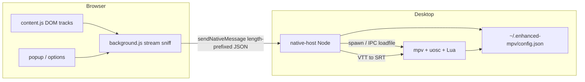

<div align="center">

# Enhanced MPV

**Turn stock mpv into a VLC-class player with one-click playback from your browser.**

[](https://github.com/nihal6886/enhanced-mpv/releases/latest)
[](https://github.com/nihal6886/enhanced-mpv/actions/workflows/ci.yml)
[](LICENSE)


[Demo](#demo) · [Quick Start](#quick-start) · [Features](#features) · [Architecture](#architecture) · [Shortcuts](#keyboard-and-mouse) · [Troubleshooting](#troubleshooting)


</div>

## Overview

Enhanced MPV is a cross-platform media ecosystem built around [mpv](https://mpv.io). It pairs the [uosc](https://github.com/tomasklaen/uosc) interface, hover thumbnails, and automatic subtitles with a Manifest V3 browser extension that hands any stream on the web to mpv in a single click.

mpv is never forked or recompiled. The entire project is Lua, `mpv.conf`, and a stdio JSON host, so every layer can be upgraded independently.

## Demo

<!-- To get an inline video player: edit this file on github.com, drag test-clip.mp4 into the editor,
     then replace the link below with the https://github.com/user-attachments/assets/... URL on its own line. -->
[Watch the demo clip](docs/screenshots/test-clip.mp4)

## Why Enhanced MPV

| You want | Enhanced MPV gives you |
|---|---|
| Playback that just works | Smart stream selection across YouTube, HLS, DASH, embeds, and direct files |
| A familiar interface | VLC-style controls with a modern neon-green UI and searchable menus |
| Subtitles without effort | Automatic local and cloud lookup, repair, and one-key sync |
| Speed | Warm-standby prewarm for sub-150 ms click-to-playback |
| Control | One config file shared by the browser extension, the host, and Lua |

## Quick Start

Setup takes two steps: run the installer, then load the extension.

### 1. Install

**Windows**

```powershell
# One-liner (zero SmartScreen, runs in memory)
irm https://raw.githubusercontent.com/nihal6886/enhanced-mpv/main/scripts/install.ps1 | iex
```

**Linux and macOS**

```bash
chmod +x scripts/install.sh native-host/host.sh
./scripts/install.sh
```

The installer registers the native host, deploys the mpv config, and links the browser extension automatically.


### 2. Load the extension

1. Open `chrome://extensions` (or `brave://extensions`, `edge://extensions`).
2. Enable **Developer mode**, choose **Load unpacked**, and select the `browser-extension` folder.

Done. Open any video page and click the extension icon.

## Features

### Playback and interface

- **ModernZ UI** with dark studio backgrounds, neon-green accents, and rounded cards
- **Floating popovers** for Quality, Audio, and Subtitles with full keyboard and mouse support
- **Dynamic window resizing** that matches the aspect ratio of any format, including 9:16 vertical video
- **Timestamp resume** so you continue exactly where you left off in the browser
- **Warm-standby prewarm** for sub-150 ms click-to-playback

### Browser bridge

- **One-click sniffing** of streams and subtitles on YouTube, Twitch, Vimeo, Jellyfin, Plex, Emby, and custom embeds
- **Edge stream selection engine** that scores every candidate and picks the best one
- **Header preservation** for hotlink-protected and authenticated streams
- **Instant micro-step feedback** in the extension popup

### Subtitles

- Automatic local scan, hash lookup, and release-name parsing
- Encoding repair, dual subtitles, and auto-sync with `ffsubsync` or `alass`
- Prefetch of the next playlist item's subtitles

### Recent fixes in v0.8.9

- **YouTube instant-EOF (-0:00 black screen) and low-resolution bug resolved.** The broken `android_vr` player client is removed, and yt-dlp now negotiates valid 1080p and 4K adaptive streams with `bestvideo[height<=2160][vcodec!*=av01]+bestaudio/best`. See [`mpv.conf`](https://github.com/nihal6886/enhanced-mpv/blob/main/mpv-config/mpv.conf) and [`mpv-launcher.js`](https://github.com/nihal6886/enhanced-mpv/blob/main/native-host/mpv-launcher.js).
- **Edge Stream Selection and Resource-Gating Engine** introduced, with deterministic multi-feature scoring and split-audio pairing for HLS. See [`background.js`](https://github.com/nihal6886/enhanced-mpv/blob/main/browser-extension/background.js) and [`stream-scoring.js`](https://github.com/nihal6886/enhanced-mpv/blob/main/native-host/stream-scoring.js).

## Architecture



| Directory | Role |
|---|---|
| `/browser-extension` | MV3 service worker, sniffs `.m3u8`, `.mpd`, `.mp4`, `.mkv`, `.webm` and captions, badge, context menus |
| `/native-host` | Native Messaging framing, sanitization, subtitle download and conversion, mpv IPC, **stream scoring and audio pairing** |
| `/mpv-config` | `mpv.conf`, `input.conf`, uosc, thumbfast, and sub-select options, Lua automations |
| `/scripts` | One-command installers and extension packaging |

JSON contracts (play payload, host replies, user config) are documented in `.cursorrules`.

## Keyboard and Mouse

VLC-style parity, with extras for power users.

<details open>
<summary><strong>Core controls</strong></summary>

| Input | Action |
|---|---|
| Left click | Play / pause |
| Double-click | Fullscreen |
| Right-click | Searchable uosc menu |
| Scroll wheel | Volume |
| `Space` | Pause |
| `f` / `Enter` | Fullscreen |
| `Ctrl+O` / `Ctrl+L` | Open file / Open URL (OS dialogs) |
| `Ctrl+B` | Save bookmark |
| `Ctrl+S` | Screenshot with subtitles to `~/Pictures/mpv-shots` |
| `L` | A-B loop |
| `1` to `5` | 0.5x / 1x / 1.25x / 1.5x / 2x (pitch correction on) |
| `/` | Search dialogue and jump |
| `E` | Next episode now |
| `t` | Always on top |
| `q` | Quit (position saved) |

</details>

<details>
<summary><strong>Subtitles and audio</strong></summary>

| Input | Action |
|---|---|
| `z` / `x` | Subtitle delay -/+ 0.1s |
| `Ctrl+Z` | Reset subtitle delay |
| `Alt+S` | Search and browse the top 10 cloud subtitles |
| `Alt+Y` | Auto-sync (`ffsubsync` or `alass`) |
| `Alt+D` | Dual subtitles (bottom and top) |
| `Alt+N` | Night Mode (`loudnorm`) |
| `Alt+H` | Hardware decode and software fallback toggle |
| `Alt+R` | Reload stream at current timestamp |

</details>

<details>
<summary><strong>ModernZ menus (v0.8.9+)</strong></summary>

| Key | Action |
|---|---|
| `q` | Open Quality menu |
| `a` | Open Audio menu |
| `s` | Open Subtitles menu |
| `Esc` | Hide menu |
| Arrow keys | Navigate |
| `Enter` | Select |
| `Ctrl+Left` | Audio sync -50 ms |
| `Ctrl+Right` | Audio sync +50 ms |
| `Ctrl+Down` | Reset audio sync |

Floating menus use dark studio (`#141820`) backgrounds, neon-green (`#4ADE80`) accents, rounded cards, hover states, and active checkmarks.

</details>

uosc keeps its slim top bar off by default (`top_bar=no`) and relies on native Windows chrome (`border=yes`) for the minimize, maximize, and close buttons. This keeps them pixel-aligned and preserves Aero Snap.

## Deep Dives

<details>
<summary><strong>Edge Stream Selection and Resource-Gating Engine</strong></summary>

<br>

A deterministic pipeline replaces ad-hoc URL sorting with a fast, bounded scoring function, `scoreStreamCandidate()`, running inside the extension background page.

**Resource bounds**

- Maximum of 15 tracked streams per tab (LRU eviction)
- Maximum of 1 in-flight manifest probe per URL (deduplicated through the `manifestResolution` Map)
- 2.5 s `AbortController` timeout on every fetch
- Zero polling loops, fully event-driven

**Scoring tiers**

| Stream type | Base score | Kind | Key behavior |
|---|---|---|---|
| **yt-dlp canonical pages** (YouTube, Vimeo, Twitch, etc.) | +2000 | `ytdlp` | Clean page URL handed to mpv and yt-dlp; raw `googlevideo.com` chunks ignored |
| **HLS master manifests** (`master.m3u8`, `index.m3u8`) | +1500 | `hls-master` | Supplies video and audio; resolution weight (+400 4K, +300 1080p, +200 720p), direct CDN bonus (+100), bandwidth hint (capped at 500) |
| **DASH MPD** (`.mpd`) | +1200 | `dash` | Resolution weight |
| **Progressive direct media** (`.mp4`, `.mkv`, `.webm`) | +800 | `progressive` | Resolution weight; ignores tiny UI and preview clips |
| **Video-only sub-playlists** (`.m3u8`, non-master) | +500 | `hls-video-only` | **Auto-pairs** with the highest-bitrate audio sub-playlist on the same tab |
| **Split audio-only sub-playlists** (`/audio/`, `mp4a`, `TYPE=AUDIO`) | +100 | `hls-audio-only` | Never played alone; paired with video |

**Audio pairing for split HLS and DASH**

When a video-only sub-playlist is selected, the engine pairs it with the highest-bitrate audio-only sub-playlist on the same tab. If the audio stream is protected by cookies or headers, the native host starts an authenticated **localhost HLS relay** ([`stream-relay.js`](https://github.com/nihal6886/enhanced-mpv/blob/main/native-host/stream-relay.js)) and passes `--audio-file=<relayedAudioUrl>` to mpv for lockstep A/V playback.

**Per-request header preservation**

The extension captures the exact inner iframe `Referer`, `Origin`, `Cookie`, and `User-Agent` headers through `webRequest.onBeforeSendHeaders` with `extraHeaders`, using `details.initiator` and `documentUrl` as fallbacks. Iframe embeds keep their own headers and are never overwritten by the parent tab URL. See [`background.js:368-396`](https://github.com/nihal6886/enhanced-mpv/blob/main/browser-extension/background.js#L368-L396).

</details>

<details>
<summary><strong>Subtitle automation</strong></summary>

<br>

On `file-loaded`, `smart-sub-manager.lua` runs this sequence:

1. Applies [mpv-sub-select](https://github.com/CogentRedTester/mpv-sub-select) rules: English audio gets forced or signs tracks; foreign audio gets full English.
2. Scans locally with fuzzy matching (`sub-auto=fuzzy`, `sub-file-paths=ass:srt:sub:subs:subtitles`).
3. If nothing matches, computes the OpenSubtitles movie hash (async `curl`, 10 s timeout, exponential backoff) or parses messy torrent names (strips `1080p`, `x265`, `WEB-DL`, and similar tags).
4. Downloads the best `.srt` as `<video>.<lang>.srt` next to the file (VLC-compatible), or into a temp directory for streams, then runs `sub-add`.
5. Repairs Windows-1252 and ISO-8859 encodings through `iconv` so glyphs never become boxes.
6. Shows OSD toasts: `Searching subtitles...`, `Loaded English subtitle`, `No match found`.
7. Treats cloud lookup as **keyless-optional**. Local files and captured web `vtt` and `srt` always work. Add a free [OpenSubtitles](https://www.opensubtitles.com/en/consumers) API key in the extension Settings page for hash search.
8. Runs `ffsubsync` or `alass` in a subprocess on `Alt+Y` and hot-reloads the retimed file.
9. Deletes temp stream subtitles older than 7 days on shutdown.
10. Prefetches the next playlist item's subtitles during the last 45 seconds.

The playback thread is never blocked: all HTTP uses `mp.command_native_async`.

</details>

<details>
<summary><strong>Browser integration</strong></summary>

<br>

- Passive `webRequest` sniffing of media and captions; tracking pixels, ads, and `.ts` chunks are dropped.
- Master `.m3u8` variants are sorted by bandwidth, and the best is pre-selected.
- The content script reads `<video>` and `<track kind="subtitles">`.
- Context menus: **Play Now in Enhanced MPV**, **Queue in MPV**, **Play Link in Enhanced MPV**.
- The popup lists streams and subtitles, follows `prefers-color-scheme`, shows a badge count, and offers an auto-intercept toggle.
- The payload includes URL, title, Referer, User-Agent, cookies (when permitted), extra headers (Jellyfin, Plex, and Emby `Authorization`), subtitle URLs, a **paired `audioUrl` for split HLS**, and **`audioHeaders` for the relay**.
- Failures return `{ ok, error, code, command }`, so the popup can explain DRM or expired tokens and offer **Copy mpv CLI command**.

**Single instance.** `input-ipc-server` is the Unix socket `~/.enhanced-mpv/mpv-socket` on Linux and macOS, or the Windows named pipe `\\.\pipe\enhanced-mpv-socket`. A second click either replaces or queues (`queueMode` in config). Right after a launch, the host retries the named pipe five times, 150 ms apart, so it reconnects cleanly while mpv brings its IPC server up.

</details>

<details>
<summary><strong>YouTube and custom web players</strong></summary>

<br>

The extension picks the right strategy per site.

**yt-dlp platforms** (youtube.com, youtu.be, vimeo.com, twitch.tv, reddit.com, x.com, twitter.com, dailymotion.com, bilibili.com)

- Raw segmented chunk URLs (`googlevideo.com`, `.m4s`, `.ts`) are filtered out.
- The clean canonical **Page URL** becomes the pre-selected primary item, labelled `Page Stream via yt-dlp (Best Video + Audio + Captions)`.
- Clicking Play hands the page URL to mpv and yt-dlp with `--ytdl-format=bestvideo[height<=2160][vcodec!*=av01]+bestaudio/bestvideo[height<=1080]+bestaudio/best` (or your configured max resolution), `--ytdl-raw-options=no-playlist=,no-check-certificates=,write-auto-subs=,sub-langs=en.*`, and `--sub-auto=fuzzy`. YouTube opens fast in 1080p or 4K with audio and English captions already attached.
- The broken `extractor-args=youtube:player_client=android_vr`, which caused 403 EOFs on adaptive streams, has been removed.

**Every other site** (custom embeds, anime players, self-hosted Jellyfin, Plex, Emby)

- The passive `webRequest` sniffer remains the primary detector for `.m3u8`, `.mpd`, `.mp4`, `.mkv`, plus `.vtt` and `.srt` captions.
- Master manifests (`master.m3u8`, `index.m3u8`, or any playlist without chunk indices) always rank above media-segment sub-playlists, so the full-quality variant wins.
- Referer and Origin are captured per tab, so streams behind hotlink checks receive both in `--http-header-fields`. Commas inside header values are escaped (`\,`), so a URL containing commas never splits into malformed headers.
- For obfuscated or blob-encrypted players, the popup always offers **Fallback: Open Page URL via yt-dlp**.

Captured WebVTT is repaired on the way in. NOTE, STYLE, and REGION blocks, cue positioning tags (`align:start position:0%`), and HTML entities are stripped so mpv never shows raw markup.

</details>

## Configuration

`~/.enhanced-mpv/config.json` is created by the installer and shared by the host and Lua. It covers:

- Preferred subtitle and native audio languages
- OpenSubtitles credentials
- yt-dlp format, queue mode, and clipboard watch
- Custom profiles (Anime Upscale, Battery Saver, Cinema HDR) switchable from uosc

The extension **Settings** page reads and writes this file through the native host, so no hand-edited conf is needed for day-to-day use.

## Windows Install Options

Both options register the native host, deploy the mpv config, and link the browser extension automatically.

1. **Smart Web Installer.** Download `EnhancedMPV-Setup.exe` from the [latest release](https://github.com/nihal6886/enhanced-mpv/releases/latest) and run it.
2. **Zero-SmartScreen one-liner** (see [Quick Start](#quick-start)). A plain PowerShell script is fetched and executed in memory. Nothing is written to disk as a `.exe`, so SmartScreen has nothing to block.

To link an unpacked build's own extension ID:

```powershell
$env:ENHANCED_MPV_EXTENSION_ID = "aaaaaaaaaaaaaaaaaaaaaaaaaaaaaaaa"
irm https://raw.githubusercontent.com/nihal6886/enhanced-mpv/main/scripts/install.ps1 | iex
```

### Verify downloads

Every release ships a `SHA256SUMS.txt` next to the binaries. Check the `.exe` before running it:

```powershell
irm https://github.com/nihal6886/enhanced-mpv/releases/latest/download/SHA256SUMS.txt
Get-FileHash .\EnhancedMPV-Setup.exe -Algorithm SHA256   # compare with the matching line
```

Sideload packages: `npm run package` writes `dist/enhanced-mpv-extension.zip` and `dist/enhanced-mpv-firefox.xpi`.

## Troubleshooting

| Symptom | What to do |
|---|---|
| Native host "not found" | Re-run the installer with the real unpacked extension ID, then check `node native-host/doctor.js` |
| YouTube opens black or shows -0:00 EOF | Confirm `yt-dlp` is on PATH. The host passes `--ytdl-format=bestvideo[height<=2160][vcodec!*=av01]+bestaudio/bestvideo[height<=1080]+bestaudio/best` for page URLs, and `android_vr` is removed |
| DRM or Widevine sites | Cannot be decrypted. Use a normal download or stream URL, or copy the CLI command from the popup to inspect |
| Garbled subtitles | `iconv` is missing, or open the subtitle file after converting it to UTF-8 |
| No uosc UI | The installer must download uosc into `~/.config/mpv/scripts` (`%APPDATA%\mpv` on Windows) |
| IPC queue does nothing | The first window must be an Enhanced MPV instance. `doctor` shows `ipc (live)` while playing |
| Auto-sync fails | Run `pip install ffsubsync` or install `alass`. Works for local files with external subtitles only |
| Split HLS has no audio | The engine auto-pairs video-only with audio-only sub-playlists. Check relay logs in `last-launch.log` |

## Development

```bash
npm install
npm test
npm run lint:js
# luacheck mpv-config/scripts   (CI installs lua-check)
npm run package
```

CI is defined in `.github/workflows/ci.yml` and runs eslint, luacheck, node tests, and the extension zip build.

## Uninstall

```bash
./scripts/install.sh --uninstall
# Windows: .\scripts\install.ps1 -Uninstall
```

This restores the most recent `mpv.conf` and `input.conf` backup and removes the native-messaging registration.

## License

Released under the [MIT License](LICENSE). Third-party projects (mpv, uosc, thumbfast, mpv-sub-select) are fetched dynamically at install time and keep their own upstream licenses. This repository vendors configuration and glue only. See [LICENSE](LICENSE) for the full text and third-party notice.
