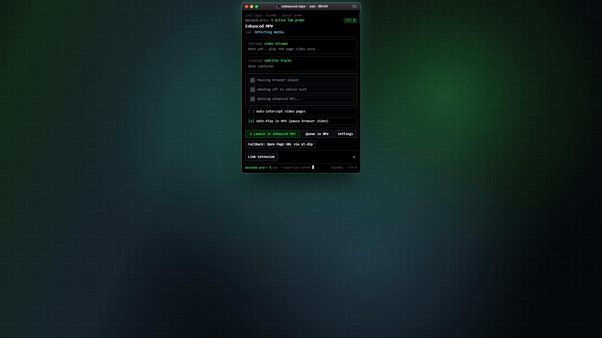
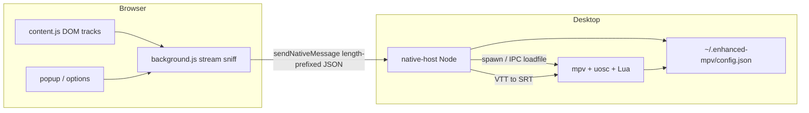

# Enhanced MPV v0.8.9 (Public Beta)




A cross-platform media ecosystem that turns stock [mpv](https://mpv.io) into a VLC-like player: [uosc](https://github.com/tomasklaen/uosc) chrome, hover thumbnails, automatic subtitles, and a Manifest V3 browser bridge (Chrome, Brave, Edge, Firefox) via a Node.js Native Messaging host.

mpv itself is never forked or recompiled. Everything is Lua, `mpv.conf`, and a stdio JSON host.

## v0.8.9 Beta Highlights

- **Edge Stream Selection & Resource-Gating Engine**: deterministic multi-feature scoring across YouTube, adaptive HLS/DASH, cross-origin iframe embeds, and direct MP4/MKV — with split-audio pairing for HLS master/sub-playlists ([browser-extension/background.js](https://github.com/enhanced-mpv/enhanced-mpv/blob/main/browser-extension/background.js), [native-host/stream-scoring.js](https://github.com/enhanced-mpv/enhanced-mpv/blob/main/native-host/stream-scoring.js))
- **Fixed YouTube Instant-EOF (-0:00 black screen) & low-resolution bug**: removed broken `android_vr` player client; yt-dlp now negotiates valid 1080p/4K adaptive streams with `bestvideo[height<=2160][vcodec!*=av01]+bestaudio/best` ([mpv-config/mpv.conf](https://github.com/enhanced-mpv/enhanced-mpv/blob/main/mpv-config/mpv.conf), [native-host/mpv-launcher.js](https://github.com/enhanced-mpv/enhanced-mpv/blob/main/native-host/mpv-launcher.js))
- One-click stream and subtitle sniffing across YouTube, Twitch, Vimeo, Jellyfin/Plex/Emby, and custom embeds
- Browser timestamp resume — pick up exactly where you left off
- ModernZ neon-green UI with zero purple idle logo, dynamic aspect-ratio window resizing for all formats including 9:16 vertical
- Quality, Audio, and Subtitles floating popovers with full keyboard and mouse support
- Warm-standby prewarm for sub-150 ms click-to-playback
- Instant micro-step feedback in the extension popup

## Quick Start (2 Steps)

### Windows

```powershell
# One-liner (zero SmartScreen, runs in memory)
irm https://raw.githubusercontent.com/enhanced-mpv/enhanced-mpv/main/scripts/install.ps1 | iex
```

### Linux / macOS

```bash
chmod +x scripts/install.sh native-host/host.sh
./scripts/install.sh
```

### Then load the extension

1. Open `chrome://extensions` (or `brave://extensions`, `edge://extensions`)
2. Enable Developer mode → Load unpacked → select the `browser-extension` folder

That's it. The installer registers the native host, deploys the mpv config, and links the browser extension automatically.

## Architecture



| Directory | Role |
|---|---|
| `/browser-extension` | MV3 service worker, sniff `.m3u8/.mpd/.mp4/.mkv/.webm` + captions, badge, context menus |
| `/native-host` | Native Messaging framing, sanitization, subtitle download/convert, mpv IPC, **stream scoring & audio pairing** |
| `/mpv-config` | `mpv.conf`, `input.conf`, uosc/thumbfast/sub-select opts, Lua automations |
| `/scripts` | One-command installers and extension packaging |

JSON contracts (play payload, host replies, user config) are documented in `.cursorrules`. Any layer can be upgraded independently.

## Windows Install Options

Two options, both of which register the native host, deploy the mpv config, and link the browser extension automatically:

1. **Smart Web Installer**: download `EnhancedMPV-Setup.exe` from the [latest release](https://github.com/enhanced-mpv/enhanced-mpv/releases/latest) and run it.
2. **Zero-SmartScreen one-liner** (shown above): a plain PowerShell script fetched and executed in memory. Nothing is written to disk as a `.exe`, so SmartScreen has nothing to block.

To link an unpacked build's own extension ID:

```powershell
$env:ENHANCED_MPV_EXTENSION_ID = "aaaaaaaaaaaaaaaaaaaaaaaaaaaaaaaa"
irm https://raw.githubusercontent.com/enhanced-mpv/enhanced-mpv/main/scripts/install.ps1 | iex
```

### Verify Downloads

Every release ships a `SHA256SUMS.txt` next to the binaries. Check the `.exe` before running it:

```powershell
irm https://github.com/enhanced-mpv/enhanced-mpv/releases/latest/download/SHA256SUMS.txt
Get-FileHash .\EnhancedMPV-Setup.exe -Algorithm SHA256   # compare with the matching line
```

Sideload zips: `npm run package` writes `dist/enhanced-mpv-extension.zip` and `dist/enhanced-mpv-firefox.xpi`.

## Keyboard and Mouse (VLC Parity)

| Input | Action |
|---|---|
| Left click | Play / pause |
| Double-click | Fullscreen |
| Right-click | Searchable uosc menu |
| Scroll wheel | Volume |
| Space | Pause |
| `f` / Enter | Fullscreen |
| `z` / `x` | Subtitle delay -/+ 0.1s |
| `Ctrl+Z` | Reset sub delay |
| `Alt+S` | Search / browse top 10 cloud subtitles |
| `Alt+Y` | Auto-sync (`ffsubsync` or `alass`) |
| `Alt+D` | Dual subtitles (bottom + top) |
| `Alt+N` | Night Mode (`loudnorm`) |
| `Alt+H` | Hardware decode <-> software fallback |
| `Alt+R` | Reload stream at current timestamp |
| `Ctrl+O` / `Ctrl+L` | Open file / Open URL (OS dialogs) |
| `Ctrl+B` | Save bookmark |
| `Ctrl+S` | Screenshot with subtitles -> `~/Pictures/mpv-shots` |
| `L` | A-B loop |
| `1` to `5` | 0.5x / 1x / 1.25x / 1.5x / 2x (pitch correction on) |
| `/` | Search dialogue and jump |
| `E` | Next episode now |
| `t` | Always on top |
| `q` | Quit (position saved) |

uosc keeps a slim top bar off by default (`top_bar=no`) and relies on native Windows chrome (`border=yes`) for the minimize / maximize / close buttons, so they stay pixel-aligned and Aero Snap works.

## ModernZ UI Controls (v0.8.9+)

| Key | Action |
|---|---|
| `q` | Open Quality menu |
| `a` | Open Audio menu |
| `s` | Open Subtitles menu |
| `ESC` | Hide menu |
| Arrow keys | Navigate |
| `Enter` | Select |
| `Ctrl+Left` | Audio sync -50ms |
| `Ctrl+Right` | Audio sync +50ms |
| `Ctrl+Down` | Reset audio sync |

Mouse-friendly floating menus with dark studio (#141820) backgrounds, neon-green (#4ADE80) accents, rounded cards, hover states, and active checkmarks.

## Edge Stream Selection & Resource-Gating Engine (v0.8.9+)

The new deterministic stream selection pipeline replaces ad-hoc URL sorting with a fast, bounded scoring function `scoreStreamCandidate()` running inside the extension background page:

### Resource Bounds
- **Max 15 tracked streams per tab** (LRU eviction)
- **Max 1 in-flight manifest probe per URL** (deduplication via `manifestResolution` Map)
- **2.5s AbortController timeout** for all fetches
- **Zero polling loops** — entirely event-driven

### Scoring Tiers

| Stream Type | Base Score | Kind | Key Behavior |
|---|---|---|---|
| **yt-dlp canonical pages** (YouTube, Vimeo, Twitch, etc.) | +2000 | `ytdlp` | Clean page URL handed to mpv+yt-dlp; raw `googlevideo.com` chunks ignored |
| **HLS Master Manifests** (`master.m3u8`, `index.m3u8`) | +1500 | `hls-master` | Auto-supplies video+audio; resolution weight (+400 4K, +300 1080p, +200 720p), direct CDN bonus (+100), bandwidth hint (capped 500) |
| **Split Audio-Only Sub-Playlists** (`/audio/`, `mp4a`, `TYPE=AUDIO`) | +100 | `hls-audio-only` | Never played alone; paired with video |
| **Video-Only Sub-Playlists** (`.m3u8` non-master) | +500 | `hls-video-only` | **Auto-pairs** with highest-bitrate audio sub-playlist on same tab |
| **DASH MPD** (`.mpd`) | +1200 | `dash` | Resolution weight |
| **Progressive Direct Media** (`.mp4`, `.mkv`, `.webm`) | +800 | `progressive` | Resolution weight; ignores tiny UI/preview clips |

### Audio Pairing for Split HLS/DASH

When a video-only sub-playlist is selected, the engine automatically pairs it with the highest-bitrate audio-only sub-playlist on the same tab. If the audio stream is protected by cookies/headers, the native host starts an authenticated **localhost HLS relay** ([native-host/stream-relay.js](https://github.com/enhanced-mpv/enhanced-mpv/blob/main/native-host/stream-relay.js)) and passes `--audio-file=<relayedAudioUrl>` to mpv for lockstep A/V playback.

### Per-Request Header Preservation

The extension captures exact inner iframe `Referer`, `Origin`, `Cookie`, and `User-Agent` headers via `webRequest.onBeforeSendHeaders` with `extraHeaders` + `details.initiator`/`documentUrl` fallback. Iframe embeds keep their exact headers — never overwritten by the parent tab URL. See [browser-extension/background.js:368-396](https://github.com/enhanced-mpv/enhanced-mpv/blob/main/browser-extension/background.js#L368-L396).

## Subtitle Automation

On `file-loaded`, `smart-sub-manager.lua`:

1. Uses [mpv-sub-select](https://github.com/CogentRedTester/mpv-sub-select) rules: English audio -> forced/signs; foreign audio -> English full.
2. Fuzzy local scan (`sub-auto=fuzzy`, `sub-file-paths=ass:srt:sub:subs:subtitles`).
3. If nothing matches, computes the OpenSubtitles movie hash (async `curl`, 10s timeout, exponential backoff) or parses messy torrent names (strips `1080p`, `x265`, `WEB-DL`, ...).
4. Downloads the best `.srt` as `<video>.<lang>.srt` next to the file (VLC-compatible) or into a temp dir for streams, then `sub-add`.
5. Repairs Windows-1252 / ISO-8859 via `iconv` so glyphs never become boxes.
6. OSD toasts: `Searching subtitles...` / `Loaded English subtitle` / `No match found`.
7. Cloud lookup is **keyless-optional**. Local files and captured web `vtt/srt` always work. Add a free [OpenSubtitles](https://www.opensubtitles.com/en/consumers) API key in the extension Settings page for hash search.
8. `Alt+Y` runs `ffsubsync` or `alass` in a subprocess and hot-reloads the retimed file.
9. Shutdown deletes temp stream subs older than 7 days.
10. The next playlist item's subtitles are prefetched in the last 45 seconds.

Never blocks the playback thread: all HTTP uses `mp.command_native_async`.

## Browser Integration

- Passive `webRequest` sniff of media + captions; tracking pixels, ads, and `.ts` chunks are dropped.
- Master `.m3u8` variants are sorted by bandwidth; the best is pre-selected.
- Content script reads `<video>` and `<track kind="subtitles">`.
- Context menus: **Play Now in Enhanced MPV**, **Queue in MPV**, **Play Link in Enhanced MPV**.
- Popup lists streams/subs, dark/light via `prefers-color-scheme`, badge count, auto-intercept toggle.
- Payload includes URL, title, Referer, User-Agent, cookies (when permitted), extra headers (Jellyfin/Plex/Emby `Authorization`), subtitle URLs, **paired `audioUrl` for split HLS**, and **`audioHeaders` for relay**.
- Failures return `{ ok, error, code, command }` so the popup can explain DRM/expired tokens and **Copy mpv CLI command**.

Single-instance: `input-ipc-server` is the Unix socket `~/.enhanced-mpv/mpv-socket` on Linux/macOS, or the Windows named pipe `\\.\pipe\enhanced-mpv-socket`. A second click either replaces or queues (`queueMode` in config). The host retries the named pipe five times (150 ms apart) right after a launch so it reconnects cleanly while mpv is still bringing its IPC server up.

## YouTube and Custom Web Players

The extension picks the right strategy per site, so playback just works:

**yt-dlp platforms** (youtube.com, youtu.be, vimeo.com, twitch.tv, reddit.com, x.com, twitter.com, dailymotion.com, bilibili.com):

- Raw segmented chunk URLs (`googlevideo.com`, `.m4s`, `.ts`) are filtered out of the list.
- The clean canonical **Page URL** is registered as the primary, pre-selected item and labelled `Page Stream via yt-dlp (Best Video + Audio + Captions)`.
- Clicking Play hands the page URL to mpv + yt-dlp with `--ytdl-format=bestvideo[height<=2160][vcodec!*=av01]+bestaudio/bestvideo[height<=1080]+bestaudio/best` (or your configured max resolution), `--ytdl-raw-options=no-playlist=,no-check-certificates=,write-auto-subs=,sub-langs=en.*`, and `--sub-auto=fuzzy`, so YouTube opens fast in crisp 1080p/4K with audio and English captions already attached.
- **Removed broken `extractor-args=youtube:player_client=android_vr`** that caused 403 EOFs on adaptive streams.

**Every other site** (custom embeds, anime players, self-hosted Jellyfin/Plex/Emby):

- The passive `webRequest` sniffer stays the primary detector for `.m3u8` / `.mpd` / `.mp4` / `.mkv` plus `.vtt` / `.srt` captions.
- Master manifests (`master.m3u8`, `index.m3u8`, or any playlist without chunk indices) always rank above media-segment sub-playlists, so the full-quality variant is chosen.
- Referer and Origin headers are captured per tab, so streams behind hotlink checks (CDN proxies) receive both in `--http-header-fields`. Commas inside header values are escaped (`\,`), so a URL containing commas never splits into malformed headers.
- For obfuscated or blob-encrypted players, the popup always offers **Fallback: Open Page URL via yt-dlp** at the bottom.

Captured WebVTT is repaired on the way in: NOTE / STYLE / REGION blocks, cue positioning tags (`align:start position:0%`), and HTML entities are stripped so mpv never shows raw markup.

## Settings

`~/.enhanced-mpv/config.json` (created by the installer) is shared by the host and Lua:

- preferred subtitle / native audio languages
- OpenSubtitles credentials
- yt-dlp format, queue mode, clipboard watch
- custom profile list (Anime Upscale, Battery Saver, Cinema HDR) switched from uosc

The extension **Settings** page reads and writes that file through the native host, so no hand-edited conf is required for day-to-day use.

## Uninstall

```bash
./scripts/install.sh --uninstall
# Windows: .\scripts\install.ps1 -Uninstall
```

Restores the most recent `mpv.conf` / `input.conf` backup and removes native-messaging registration.

## Development

```bash
npm install
npm test
npm run lint:js
# luacheck mpv-config/scripts   (CI installs lua-check)
npm run package
```

CI: `.github/workflows/ci.yml` (eslint, luacheck, node tests, extension zip).

## Troubleshooting

| Symptom | What to do |
|---|---|
| Native host "not found" | Re-run installer with the real unpacked extension ID; check `node native-host/doctor.js` |
| YouTube opens black / -0:00 EOF | Confirm `yt-dlp` on PATH; the host passes `--ytdl-format=bestvideo[height<=2160][vcodec!*=av01]+bestaudio/bestvideo[height<=1080]+bestaudio/best` for page URLs; `android_vr` removed |
| DRM / Widevine sites | Cannot be decrypted. Use a normal download/stream URL. Copy CLI from the popup to inspect. |
| Garbled subtitles | `iconv` missing, or run Open Subtitle File after converting to UTF-8 |
| No uosc UI | Installer must download uosc into `~/.config/mpv/scripts` (`%APPDATA%\mpv` on Windows) |
| IPC queue does nothing | First window must be an Enhanced MPV instance; doctor shows `ipc (live)` while playing |
| Auto-sync fails | `pip install ffsubsync` or install `alass`; only local files + external subs |
| Split HLS has no audio | Engine auto-pairs video-only with audio-only sub-playlists; check relay logs in `last-launch.log` |

## License

[MIT](LICENSE). Third-party projects (mpv, uosc, thumbfast, mpv-sub-select) are fetched dynamically at install time and keep their own upstream licenses; this repo vendors configuration and glue only. See [LICENSE](LICENSE) for the full text and third-party notice.# enhanced-mpv

